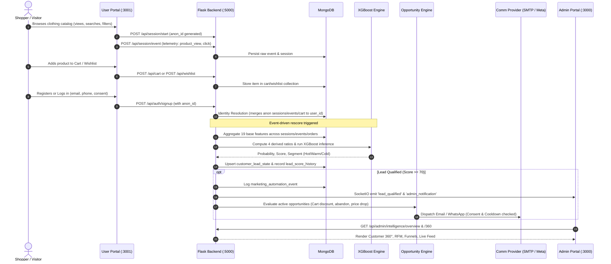
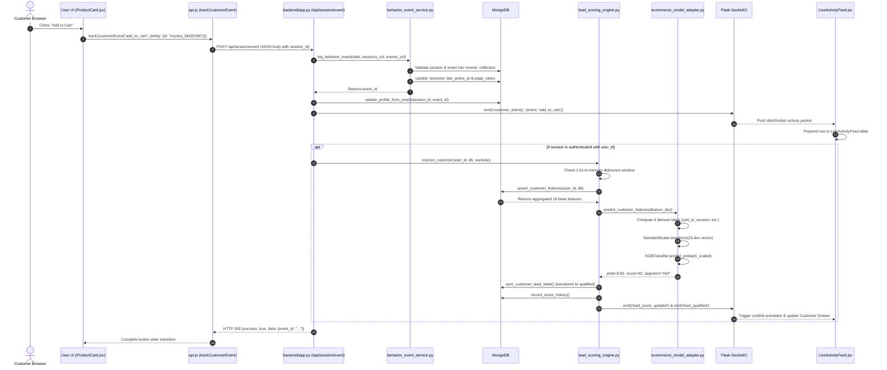
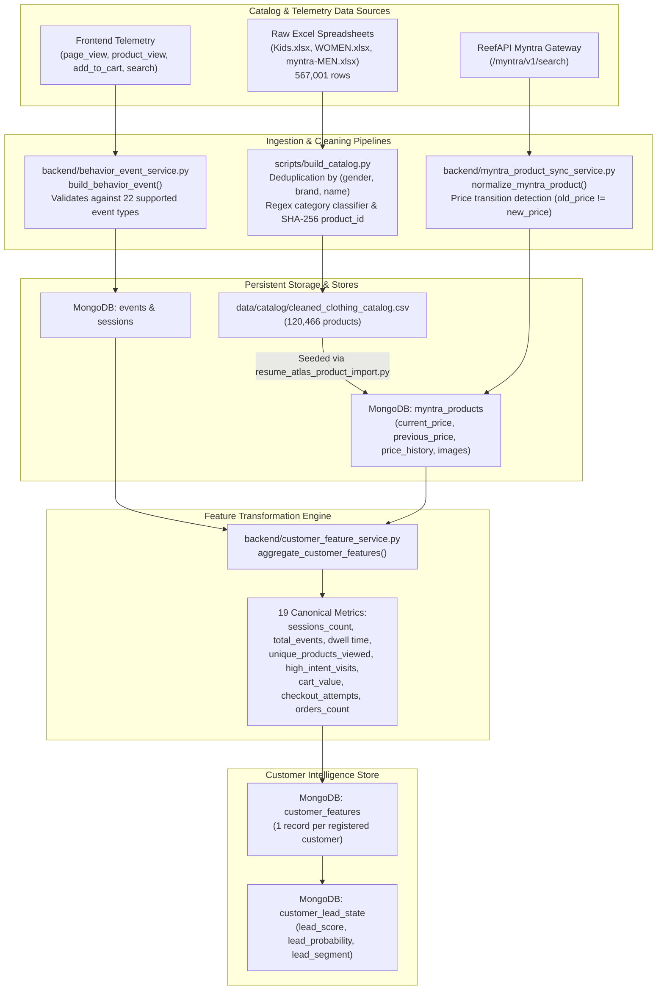
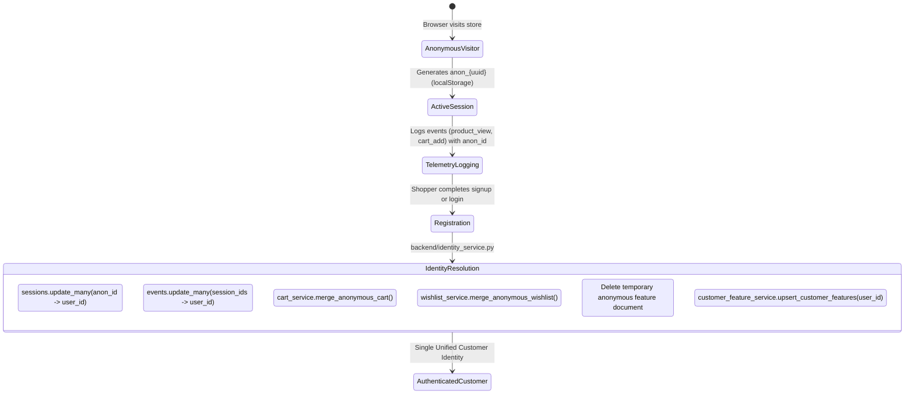

# Lead Magnet: Complete Technical Architecture Audit & Reverse Engineering Report

**Audit Type:** Reverse Engineering, Architecture Verification, and Codebase Audit  
**Target Repository:** `Lead Magnet` (E-Commerce Customer Intelligence & Lead-Scoring Platform)  
**Workspace Root:** `d:\lead-magnet`  
**Auditor:** Senior Software Architect, Backend Engineer, Data Engineer & ML Specialist  
**Execution Mode:** Pure Analysis and Documentation (Zero code mutations, zero package installations, zero database writes, zero external API requests)  
**Date of Audit:** October 2026  

---

## Table of Contents

1. [Executive Summary](#1-executive-summary)
2. [Project Purpose and Business Workflow](#2-project-purpose-and-business-workflow)
3. [Repository Inventory](#3-repository-inventory)
4. [Verified Technology Stack](#4-verified-technology-stack)
5. [Software Architecture Diagrams](#5-software-architecture-diagrams)
   - 5.1 [High-Level System Architecture](#51-high-level-system-architecture)
   - 5.2 [Request Lifecycle Diagram](#52-request-lifecycle-diagram)
   - 5.3 [Data Ingestion and Processing Pipeline](#53-data-ingestion-and-processing-pipeline)
   - 5.4 [Customer-Scoring and Qualification Pipeline](#54-customer-scoring-and-qualification-pipeline)
   - 5.5 [Deployment and Runtime Architecture](#55-deployment-and-runtime-architecture)
6. [Component Responsibilities and Module Contracts](#6-component-responsibilities-and-module-contracts)
7. [End-to-End Execution Traces](#7-end-to-end-execution-traces)
8. [Internal API Inventory](#8-internal-api-inventory)
9. [External API Inventory](#9-external-api-inventory)
10. [Product Scraping and Catalog Ingestion Implementation](#10-product-scraping-and-catalog-ingestion-implementation)
11. [Customer Identity and Behavioral Telemetry Processing](#11-customer-identity-and-behavioral-telemetry-processing)
12. [Feature Engineering](#12-feature-engineering)
13. [Exact Lead-Scoring and Propensity Algorithms](#13-exact-lead-scoring-and-propensity-algorithms)
14. [HOT, WARM, and COLD Lead Classification Rules](#14-hot-warm-and-cold-lead-classification-rules)
15. [Worked Customer Traces](#15-worked-customer-traces)
16. [Datasets and Data Processing Pipelines](#16-datasets-and-data-processing-pipelines)
17. [Database and Persistence Architecture](#17-database-and-persistence-architecture)
18. [Latency, Performance, and Bottleneck Analysis](#18-latency-performance-and-bottleneck-analysis)
19. [Caching, Concurrency, and Resilience Mechanisms](#19-caching-concurrency-and-resilience-mechanisms)
20. [Error Handling, Failure Modes, and Recovery](#20-error-handling-failure-modes-and-recovery)
21. [Security Hardening and Configuration Audit](#21-security-hardening-and-configuration-audit)
22. [Test Coverage and Verification Evidence](#22-test-coverage-and-verification-evidence)
23. [Deployment and Startup Architecture](#23-deployment-and-startup-architecture)
24. [Known Limitations, Discrepancies, and Technical Debt](#24-known-limitations-discrepancies-and-technical-debt)
25. [Glossary of Project-Specific Terminology](#25-glossary-of-project-specific-terminology)
26. [Evidence Index](#26-evidence-index)

---

## 1. Executive Summary

**Lead Magnet** is an e-commerce customer intelligence, purchase-intent scoring, and marketing automation platform built on a 3-tier architecture:
1. **User Storefront**: React 18 single-page application (`frontend/user`) serving an e-commerce catalog with search, cart, wishlist, checkout, and real-time behavioral telemetry collection.
2. **Admin Intelligence Portal**: React 18 single-page application (`frontend/admin`) providing real-time analytics, purchase funnels, RFM segmentation, customer 360° profile inspection, what-if simulations, and a live WebSocket event stream.
3. **Backend Core**: Python 3.10+ Flask application (`backend/app.py`) accompanied by domain service modules, an XGBoost machine learning scoring engine, MongoDB persistence, distributed background schedulers, and multi-channel communication adapters (Gmail SMTP and Meta WhatsApp Business Cloud API).

### Key Findings of the Technical Audit
* **Dual ML Subsystem Reality**: The codebase contains two distinct machine learning models:
  - **Legacy Model (`v1.0`)**: Located in `model/xgb_model.pkl` with `model/scaler.pkl` and `model/kmeans_model.pkl`. Trained on the legacy education B2B dataset (`data/raw/Leads.csv`). Only invoked via the standalone demo endpoint `POST /predict`.
  - **Active E-Commerce Engine (`v2.0_ecommerce_xgb`)**: Located in `model/ecommerce_xgb_model.pkl` and `model/ecommerce_scaler.pkl`. Evaluates a **23-dimensional behavioral feature vector** (19 base aggregated features + 4 derived ratios). Trained on a **6,000-sample synthetic e-commerce behavioral dataset** (`data/ml/ecommerce_customer_behavior.csv`).
* **Actual Catalog Ingestion Mechanism**: There is no live web-crawler scraping HTML from e-commerce sites. Catalog ingestion operates via two mechanisms:
  - **Static Seed Ingestion**: 120,466 products cleaned and deduplicated from 3 raw Excel spreadsheets (`Kids.xlsx`, `WOMEN.xlsx`, `myntra-MEN.xlsx` totalling 567,001 source rows) exported to `data/catalog/cleaned_clothing_catalog.csv` and seeded into MongoDB `myntra_products`.
  - **Dynamic API Sync**: Managed via **ReefAPI** (`https://api.reefapi.com`), an external REST service providing Myntra catalog search and detail endpoints. Hard credit guardrails cap requests per run (default 5, maximum 10) to preserve free credits.
* **Lead Scoring & Classification Truth**:
  - Lead Score: $0 \text{ to } 100$ ($\text{round}(\text{probability} \times 100)$).
  - Classification: **Hot** ($\ge 0.70$ probability / $\ge 70$ score), **Warm** ($0.35 \le \text{prob} < 0.70$ / $35 \le \text{score} < 70$), **Cold** ($< 0.35$ probability / $< 35$ score).
  - Customer qualification: strictly `lead_probability >= 0.70`.
  - Qualification transition (`not_qualified_to_qualified`) automatically enqueues marketing automation events and live admin alerts.
* **Communication & Multi-Channel Dispatch**:
  - Channels implemented: **Email** (via Gmail SMTP relay using `smtplib`) and **WhatsApp** (via Meta Cloud Graph API v18.0).
  - **SMS is completely absent and explicitly eliminated**.
  - No inbound Gmail reading, Gmail API OAuth2, or Google Workspace inbox querying exists in the executable code despite `google-api-python-client` appearing in `requirements.txt`.
* **Testing & Verification Status**:
  - Backend test suite contains **678 tests** across **52 test files**, running via `pytest` in **61.02 seconds** against an isolated local database (`leadmagnet_test` on `127.0.0.1:27017`).
  - Runtime isolation safeguards (`backend/tests/_isolation.py` and `backend/local_test_launcher.py`) strictly prohibit tests from connecting to MongoDB Atlas or dispatching live communications.

---

## 2. Project Purpose and Business Workflow

The primary business objective of Lead Magnet is to recover silently abandoning e-commerce visitors. Traditional e-commerce stores lose 70–80% of shoppers during browsing and checkout without identifying intent. Lead Magnet implements continuous behavioral surveillance, calculates predictive conversion propensity, and triggers automated, channel-appropriate intervention before the lead goes cold.

### Core End-to-End Business Workflow


---

## 3. Repository Inventory

The repository contains 187 tracked source and configuration files (excluding `.git`, `node_modules`, and Python virtual environments). The table below catalogs all primary architectural files:

| File Path | Responsibility | Technology | Entry Point? | Key Dependencies | Primary Data Flow | Importance |
| :--- | :--- | :--- | :---: | :--- | :--- | :--- |
| `backend/app.py` | Central application entry point, HTTP routing, Socket.IO setup, error handlers | Python / Flask | **Yes** | Flask, PyMongo, Flask-SocketIO, PyJWT, bcrypt | In: HTTP Requests; Out: JSON API responses & WebSocket events | **Critical** |
| `backend/local_test_launcher.py` | Safe isolated test launcher enforcing loopback MongoDB and dry-run dispatch | Python | **Yes** | PyMongo, os, sys | Enforces isolated environment flags | **Critical** |
| `backend/ecommerce_model_adapter.py` | E-commerce XGBoost lead scoring inference and threshold evaluation | Python | No | joblib, pandas, scikit-learn, xgboost | In: Feature doc; Out: Lead score, probability, segment | **Critical** |
| `backend/customer_feature_service.py` | Aggregates raw events, sessions, cart, wishlist, and orders into canonical feature store | Python | No | PyMongo, bson, product_lookup | In: Customer ID + DB; Out: 19 base behavioral features | **Critical** |
| `backend/customer_lead_state_service.py` | Single-document lead state synchronization and transition detection | Python | No | PyMongo, ecommerce_model_adapter | In: Feature record; Out: `customer_lead_state` doc | **Critical** |
| `backend/lead_scoring_engine.py` | Event-driven rescoring orchestrator with in-memory 1.0s debounce | Python | No | customer_feature_service, SocketIO | In: Customer ID; Out: Rescore pipeline execution | **Critical** |
| `backend/identity_service.py` | Anonymous visitor token generation and post-login identity resolution | Python | No | uuid, PyMongo, cart_service, wishlist_service | In: `anon_id`, `user_id`; Out: Merged entity collections | **Critical** |
| `backend/behavior_event_service.py` | Ingests, validates, and normalizes rich behavioral events | Python | No | bson, sessions_collection | In: JSON event; Out: `events` collection record | **Critical** |
| `backend/opportunity_engine.py` | Detects marketing opportunities (cart/wishlist discounts, abandonment, price drop) | Python | No | PyMongo, channel_selector_service | In: Customer lead state; Out: `marketing_opportunities` | **Critical** |
| `backend/channel_selector_service.py` | Smart channel selector (Email vs WhatsApp) based on consent and opportunity priority | Python | No | communication_provider | In: Customer profile & opportunity; Out: Selected channel | **Critical** |
| `backend/communication_provider.py` | Provider abstraction: DryRun, Gmail SMTP relay, Meta WhatsApp Business API | Python | No | smtplib, requests, email.mime | In: Recipient, subject, body; Out: Message delivery ID | **Critical** |
| `backend/price_drop_opportunity_service.py` | Matches catalog price drop events to active customer carts and wishlists | Python | No | opportunity_engine, PyMongo | In: Price change event; Out: Price drop opportunity | **Critical** |
| `backend/whatsapp_webhook_service.py` | Handles Meta Webhook verification challenge, HMAC signatures, and STOP opt-outs | Python | No | hmac, hashlib, customer_profile_service | In: Meta webhook POST/GET; Out: Opt-out updates | **Critical** |
| `backend/scheduler_service.py` | Background daemon orchestrating periodic opportunity scans and catalog refresh | Python | **Yes** | threading, PyMongo (distributed leases) | Triggers background jobs every 1800s–3600s | **Critical** |
| `backend/admin_intelligence_service.py` | Service layer for Admin dashboard KPIs, customer 360° drawer, and notifications | Python | No | PyMongo, rfm_service, retention_service | In: Query parameters; Out: Sanitized analytics payloads | **Critical** |
| `backend/product_lookup.py` | Normalizes product queries supporting string `myntra_*` IDs and legacy ObjectIds | Python | No | bson, PyMongo | In: Product ID; Out: Canonical product document | **Critical** |
| `backend/cart_service.py` | Persistent shopping cart CRUD with price and availability lookups | Python | No | PyMongo, product_lookup | In: User/Anon ID + items; Out: `cart` collection state | **Critical** |
| `backend/wishlist_service.py` | Persistent wishlist CRUD operations | Python | No | PyMongo, product_lookup | In: User/Anon ID + items; Out: `wishlist` collection state | **Critical** |
| `backend/order_service.py` | Checkout order creation, cart clearance, and price snapshotting | Python | No | PyMongo, cart_service | In: Cart items + address; Out: `orders` collection record | **Critical** |
| `backend/rfm_service.py` | Calculates Recency, Frequency, Monetary quintiles and assigns customer segment | Python | No | PyMongo, bson | In: Orders history; Out: RFM scores and segment name | Supporting |
| `backend/funnel_analytics_service.py` | Computes dynamic e-commerce purchase funnel metrics across events | Python | No | PyMongo (sessions, events, orders) | In: Database collections; Out: Funnel drop-off rates | Supporting |
| `backend/revenue_attribution_service.py` | Correlates qualified lead timestamps with subsequent order revenues | Python | No | PyMongo (lead_state, orders) | In: Lead qualification date; Out: Attributed revenue | Supporting |
| `backend/whatif_simulator_service.py` | Sandboxed what-if lead score simulator without modifying database | Python | No | ecommerce_model_adapter | In: Feature overrides; Out: Simulated lead score | Supporting |
| `backend/retention_service.py` | Heuristic inactivity risk and engagement trend analysis | Python | No | PyMongo, customer_feature_service | In: Customer ID; Out: Churn risk level (Low/Med/High) | Supporting |
| `backend/model_explainability_service.py` | Computes directional feature contributions via z-scores and feature importances | Python | No | ecommerce_model_adapter | In: Feature doc; Out: Top driving factors | Supporting |
| `backend/myntra_product_sync_service.py` | Syncs live Myntra products from ReefAPI into MongoDB tracking price drops | Python | No | reef_api_client, PyMongo | In: ReefAPI response; Out: Upserted `myntra_products` | Supporting |
| `backend/myntra_catalog_refresh_service.py` | Credit-safe batch search refresh of Myntra products (15-day interval, cart priority) | Python | No | reef_api_client, myntra_product_sync | In: Database state; Out: Synchronized catalog | Supporting |
| `backend/reef_api_client.py` | HTTP client for ReefAPI Myntra endpoints (`/search`, `/detail`) with credit safety | Python | No | requests, dotenv | In: Query / product_id; Out: Normalized product dict | Supporting |
| `backend/auth_middleware.py` | Flask request decorators for JWT verification (`@token_required`, `@admin_required`) | Python | No | pyjwt, flask | In: Authorization header; Out: Decoded `g.current_user` | **Critical** |
| `backend/seed_clothing_products.py` | Seeds initial synthetic clothing products if database is empty | Python | **Yes** | PyMongo, dotenv | In: Hardcoded product definitions; Out: `products` | Supporting |
| `backend/tests/_isolation.py` | Test isolation engine validating loopback URIs and preventing Atlas access | Python | No | os, sys | Enforces loopback MongoDB in tests | **Critical** |
| `backend/tests/conftest.py` | Pytest fixtures and test database isolation hooks | Python | No | pytest, _isolation | Configures test fixtures and clean DB state | **Critical** |
| `backend/requirements.txt` | Backend dependency manifest | Pip manifest | No | None | Declares Python library requirements | Configuration |
| `frontend/user/src/main.jsx` | User portal entry point | JavaScript / React | **Yes** | react-dom/client, App.jsx | Mounts React application into `#root` | **Critical** |
| `frontend/user/src/App.jsx` | User portal router and layout shell with global ParticleDrift background | JSX / React | No | react-router-dom, AuthContext | Configures customer routes | **Critical** |
| `frontend/user/src/services/api.js` | Central API client for User Portal handling sessions, tracking, cart, and orders | JavaScript | No | window.fetch, localStorage | Connects frontend to backend REST endpoints | **Critical** |
| `frontend/user/src/context/AuthContext.jsx` | Customer & Admin session state provider in User Portal | JSX / React | No | localStorage, api.js | Manages user credentials and JWT storage | **Critical** |
| `frontend/user/src/context/UserTrackingContext.jsx`| Local behavioral telemetry tracking provider | JSX / React | No | localStorage | Tracks dwell time and in-memory clicks | Supporting |
| `frontend/user/package.json` | User Portal dependencies and npm scripts | JSON | No | Vite, React 18, Recharts | Build and runtime dependencies | Configuration |
| `frontend/admin/src/main.jsx` | Admin intelligence portal entry point | JavaScript / React | **Yes** | react-dom/client, App.jsx | Mounts Admin application into `#root` | **Critical** |
| `frontend/admin/src/App.jsx` | Admin Portal layout, KPI summary, customer directory, and tab navigator | JSX / React | No | react-router-dom, AdminAuthContext | Configures admin routes and state | **Critical** |
| `frontend/admin/src/services/api.js` | Central API client for Admin Portal connecting to all intelligence endpoints | JavaScript | No | window.fetch | Connects Admin UI to backend API | **Critical** |
| `frontend/admin/src/components/customers/CustomerDetailDrawer.jsx` | Slide-out Customer 360° deep dive drawer | JSX / React | No | Recharts, Lucide Icons | Displays customer timeline, features, explainability | **Critical** |
| `frontend/admin/src/components/analytics/LiveActivityFeed.jsx` | Real-time live activity feed connecting via Socket.IO | JSX / React | No | socket.io-client, Lucide Icons | Renders real-time browsing and scoring feed | **Critical** |
| `frontend/admin/package.json` | Admin Portal dependencies and npm scripts | JSON | No | Vite, React 18, Socket.IO Client | Build and runtime dependencies | Configuration |
| `scripts/build_catalog.py` | Cleans raw Excel files and compiles 120,466-product clothing catalog | Python | **Yes** | openpyxl / zipfile, hashlib, csv | In: 3 raw Excel files; Out: cleaned CSV & JSON | Data Processing |
| `scripts/generate_ecommerce_dataset.py`| Generates 6,000-sample synthetic behavioral dataset for ML training | Python | **Yes** | numpy, pandas | In: Random distributions; Out: `ecommerce_customer_behavior.csv` | Data Processing |
| `scripts/train_ecommerce_model.py` | Trains XGBoost classifier and exports dedicated e-commerce model artifacts | Python | **Yes** | scikit-learn, xgboost, joblib | In: Synthetic dataset; Out: `ecommerce_xgb_model.pkl` | Data Processing |
| `run_tests.py` | Standalone test runner applying isolation guards before launching pytest | Python | **Yes** | pytest, os, sys | Executes 678 backend regression tests | Operational Tool |

---

## 4. Verified Technology Stack

The table below contrasts **declared dependencies** in package manifests with **empirically verified imports** in executable code:

| Layer / Subsystem | Declared Technology & Manifest | Verified Executable Imports | Verification Status | Architectural Role |
| :--- | :--- | :--- | :---: | :--- |
| **Backend Web Framework** | `Flask==3.1.3` (`requirements.txt:31`) | `from flask import Flask, request, jsonify, g` (`backend/app.py:1`) | **Verified Active** | Core HTTP server, routing, error handling |
| **CORS Middleware** | `Flask-Cors==6.0.1` (`requirements.txt:32`) | `from flask_cors import CORS` (`backend/app.py:2`) | **Verified Active** | Whitelist-based origin protection |
| **WebSocket / Realtime** | `Flask-SocketIO==5.6.1` (`requirements.txt:33`), `python-socketio==5.15.0` | `from flask_socketio import SocketIO` (`backend/app.py:5`) | **Verified Active** | Real-time push of admin notifications and live feed |
| **WSGI Server & Async** | `gunicorn==23.0.0`, `eventlet==0.40.4` | Used in `backend/Procfile:1` and `backend/render.yaml:10` | **Verified Active** | Production single-worker Eventlet WSGI runner |
| **Database Driver** | `pymongo==4.18.1`, `dnspython==2.8.0` | `from pymongo import MongoClient` (`backend/app.py:14`) | **Verified Active** | MongoDB connection, querying, and indexing |
| **TLS Certificates** | `certifi==2026.4.22` | `import certifi` (`backend/app.py:85`) | **Verified Active** | Secure CA certificate verification for Atlas TLS |
| **Authentication & Crypto**| `PyJWT==2.10.1`, `bcrypt==5.0.0` | `import jwt`, `import bcrypt` (`backend/app.py:8-9`) | **Verified Active** | Password hashing (bcrypt) and JWT issuing (HS256) |
| **HTTP Client** | `requests==2.34.2`, `urllib3==2.7.0` | `import requests` (`backend/reef_api_client.py:13`) | **Verified Active** | Outbound requests to ReefAPI and Meta Cloud API |
| **Email Protocol** | Standard Library (`smtplib`, `email.mime`) | `import smtplib`, `from email.mime.text import MIMEText` | **Verified Active** | Direct SMTP relay through Gmail (`smtp.gmail.com:587`) |
| **Machine Learning Engine**| `xgboost==3.4.1`, `scikit-learn==1.9.1` | `from xgboost import XGBClassifier`, `from sklearn.preprocessing import StandardScaler` | **Verified Active** | Feature scaling and purchase propensity scoring |
| **Data Processing** | `pandas==3.0.6`, `numpy==2.5.3` | `import pandas as pd`, `import numpy as np` | **Verified Active** | Vector construction, dataframe conversions |
| **Model Serialization** | `joblib==1.5.3` | `import joblib` (`backend/ecommerce_model_adapter.py:13`) | **Verified Active** | Loading serialized model and scaler binaries |
| **Testing Harness** | `pytest==9.1.1` | Executed via `run_tests.py:86` | **Verified Active** | 678 automated regression tests |
| **User Frontend Core** | `react@^18.3.1`, `react-dom@^18.3.1` | `import React from 'react'` (`frontend/user/src/App.jsx:1`) | **Verified Active** | User Portal UI hierarchy |
| **User Frontend Router**| `react-router-dom@^6.28.0` | `import { HashRouter ... } from 'react-router-dom'` | **Verified Active** | Hash-based client-side routing (`#/...`) |
| **User Frontend Build** | `vite@^6.0.7`, `@vitejs/plugin-react` | Executed via `npm run dev --port 3001` | **Verified Active** | Vite 6 development server and rollup packager |
| **Admin Frontend Core** | `react@^18.3.1`, `react-dom@^18.3.1` | `import React from 'react'` (`frontend/admin/src/App.jsx:1`)| **Verified Active** | Admin Intelligence UI hierarchy |
| **Admin Frontend Router**| `react-router-dom@^7.18.2` | `import { HashRouter ... } from 'react-router-dom'` | **Verified Active** | Hash-based client-side routing |
| **Admin Realtime Client**| `socket.io-client@^4.8.3` | `import { io } from 'socket.io-client'` | **Verified Active** | WebSocket client receiving real-time event stream |
| **Charting Library** | `recharts@^2.15.0` (admin), `^3.10.1` (user) | `import { ResponsiveContainer, BarChart, ... }` | **Verified Active** | Funnel, RFM, and distribution data visualizations |
| **UI Icons** | `lucide-react@^0.469.0` | `import { Eye, ShoppingCart, ... } from 'lucide-react'` | **Verified Active** | Vector iconography |
| **Styling** | Vanilla CSS (CSS files & inline CSS properties) | `import '../styles/index.css'`, inline style blocks | **Verified Active** | Pure CSS styling. TailwindCSS is completely absent. |

### Declared But Unused (Phantom) Dependencies
The file `backend/requirements.txt` contains numerous heavy packages resulting from an uncurated pip freeze that are **never imported or executed** in the application:
* `torch==2.12.1`, `transformers==5.12.1`, `sentence-transformers==5.6.0`, `safetensors==0.8.0` (Zero PyTorch or Transformer models exist).
* `langchain==1.3.10`, `langgraph==1.2.6`, `langsmith==0.8.18` (Zero LangChain chains exist).
* `fastapi==0.136.1`, `starlette==1.0.0`, `uvicorn==0.46.0` (Backend runs exclusively on Flask).
* `streamlit==1.58.0` (Zero Streamlit apps exist).
* `biopython==1.87` (Irrelevant bioinformatics library).
* `google-api-python-client==2.197.0`, `google-auth==2.55.0` (Zero Google API client code exists; Gmail uses direct SMTP via `smtplib`).

---

## 5. Software Architecture Diagrams

### 5.1 High-Level System Architecture

```mermaid
graph TB
    subgraph Client_Tier [Client Presentation Tier]
        UserApp["User Storefront Portal<br/>(React 18 / Vite :3001)"]
        AdminApp["Admin Intelligence Portal<br/>(React 18 / Vite :3000)"]
    end

    subgraph Gateway_Tier [Application & API Gateway Tier]
        FlaskAPI["Flask Application (backend/app.py)<br/>WSGI: Gunicorn + Eventlet (:5000)"]
        CORSGuard["CORS Guard & Security Headers"]
        AuthMiddleware["JWT Auth Middleware<br/>(@token_required, @admin_required)"]
        SocketIOServer["Flask-SocketIO Server<br/>(Live Event Emitter)"]
    end

    subgraph Service_Tier [Business Logic & Intelligence Services]
        IdentitySvc["Identity Service<br/>(Anonymous to User Resolution)"]
        EventSvc["Behavior Event Ingestion<br/>(Telemetry Logging)"]
        CartWishSvc["Cart & Wishlist Services"]
        OrderSvc["Order Processing Service"]
        FeatureSvc["Customer Feature Store<br/>(19 Base Metrics Aggregation)"]
        ScoringEngine["Lead Scoring Engine<br/>(Rescore Orchestrator + 1s Debounce)"]
        ModelAdapter["E-Commerce ML Adapter<br/>(XGBoost Propensity Scorer)"]
        ExplainSvc["Model Explainability Service<br/>(Z-Score Directional Contributions)"]
        OppEngine["Opportunity Engine<br/>(Discounts, Abandonment, Price Drop)"]
        ChannelSelector["Smart Channel Selector<br/>(Consent & Preference Routing)"]
        CommProvider["Communication Provider<br/>(DryRun / Gmail SMTP / Meta WhatsApp)"]
        AdminIntelSvc["Admin Intelligence Service<br/>(Customer 360, RFM, Funnel, Attribution)"]
    end

    subgraph Async_Tier [Background Automation & Schedulers]
        Scheduler["Background Scheduler Daemon<br/>(scheduler_service.py)"]
        DistributedLock["Distributed Leases<br/>(scheduler_locks in MongoDB)"]
        CatalogRefresh["Myntra Catalog Refresh Service<br/>(ReefAPI Batch Search / Credit Safe)"]
    end

    subgraph External_Tier [External Services & Data Sources]
        ReefAPI["ReefAPI Myntra Gateway<br/>(https://api.reefapi.com)"]
        GmailSMTP["Gmail SMTP Relay<br/>(smtp.gmail.com:587)"]
        MetaWhatsApp["Meta WhatsApp Cloud API<br/>(graph.facebook.com/v18.0)"]
        MetaWebhook["Meta Inbound Webhook<br/>(/api/webhook/whatsapp)"]
    end

    subgraph Persistence_Tier [MongoDB Database Tier (:27017)]
        DB_Users["user_profiles"]
        DB_Catalog["myntra_products (120,466 items)"]
        DB_Telemetry["sessions, events"]
        DB_Commerce["cart, wishlist, orders"]
        DB_Intelligence["customer_features, customer_lead_state"]
        DB_Marketing["marketing_automation_events,<br/>marketing_communications,<br/>marketing_opportunities"]
        DB_Admin["admin_notifications, lead_score_history"]
    end

    UserApp -->|REST HTTP| FlaskAPI
    AdminApp -->|REST HTTP| FlaskAPI
    AdminApp <-->|WebSocket EngineIO| SocketIOServer

    FlaskAPI --> CORSGuard --> AuthMiddleware
    FlaskAPI --> IdentitySvc
    FlaskAPI --> EventSvc
    FlaskAPI --> CartWishSvc
    FlaskAPI --> OrderSvc
    FlaskAPI --> AdminIntelSvc

    EventSvc --> DB_Telemetry
    EventSvc --> ScoringEngine
    OrderSvc --> DB_Commerce
    OrderSvc --> ScoringEngine

    ScoringEngine --> FeatureSvc
    FeatureSvc --> DB_Telemetry
    FeatureSvc --> DB_Commerce
    FeatureSvc --> DB_Intelligence
    ScoringEngine --> ModelAdapter
    ModelAdapter --> DB_Intelligence
    ScoringEngine --> SocketIOServer

    ScoringEngine --> OppEngine
    OppEngine --> ChannelSelector
    ChannelSelector --> CommProvider
    CommProvider --> GmailSMTP
    CommProvider --> MetaWhatsApp

    Scheduler --> DistributedLock
    Scheduler --> OppEngine
    Scheduler --> CatalogRefresh
    CatalogRefresh --> ReefAPI
    CatalogRefresh --> DB_Catalog

    MetaWebhook --> FlaskAPI
```

---

### 5.2 Request Lifecycle Diagram

The diagram below traces an authentic user event (such as viewing a product, adding to cart, or triggering qualification) from the React UI through backend verification to admin dashboard rendering:



---

### 5.3 Data Ingestion and Processing Pipeline



---

### 5.4 Customer-Scoring and Qualification Pipeline

```mermaid
flowchart LR
    subgraph Inputs [Behavioral Signal Inputs]
        EventsDB[("events")]
        SessionsDB[("sessions")]
        CartDB[("cart")]
        WishlistDB[("wishlist")]
        OrdersDB[("orders")]
    end

    subgraph Extraction [1. Feature Aggregation (customer_feature_service.py)]
        F1["19 Base Features Extracted:<br/>sessions_count, total_events, total_time_spent,<br/>avg_duration, page_views, days_since_last_activity,<br/>products_viewed, unique_viewed, interactions,<br/>searches, form_submits, high_intent_visits,<br/>cart_items, cart_value, wishlist_items,<br/>checkout_attempts, orders_count, order_value, aov"]
    end

    subgraph Ratios [2. Feature Engineering (ecommerce_model_adapter.py)]
        F2["4 Derived Ratios Computed:<br/>cart_to_session_ratio = cart_items / sessions<br/>checkout_to_cart_ratio = checkouts / max(cart, 1)<br/>high_intent_ratio = high_intent / max(pages, 1)<br/>interaction_density = interactions / sessions"]
    end

    subgraph ML_Inference [3. Scaling & Model Scoring]
        Vector["23-Dimensional Feature Vector<br/>Ordered per ecommerce_feature_columns.pkl"]
        Scaler["StandardScaler.transform(X)<br/>(ecommerce_scaler.pkl)"]
        XGBoost["XGBClassifier.predict_proba(X_scaled)<br/>(ecommerce_xgb_model.pkl)"]
        Prob["Conversion Probability: prob ∈ [0.0, 1.0]<br/>Lead Score: round(prob * 100) ∈ [0, 100]"]
    end

    subgraph Segmentation [4. Thresholding & State Sync]
        Hot["HOT Lead (prob >= 0.70)<br/>Qualification: 'qualified'"]
        Warm["WARM Lead (0.35 <= prob < 0.70)<br/>Qualification: 'not_qualified'"]
        Cold["COLD Lead (prob < 0.35)<br/>Qualification: 'not_qualified'"]
    end

    subgraph Downstream [5. Downstream Actions]
        StateDB[("customer_lead_state")]
        ScoreHistoryDB[("lead_score_history")]
        Automation["Marketing Automation Event<br/>(if newly qualified)"]
        SocketIO["SocketIO Live Notification<br/>(lead_qualified / lead_score_updated)"]
    end

    Inputs --> Extraction
    Extraction --> F1
    F1 --> Ratios
    Ratios --> F2
    F2 --> Vector
    Vector --> Scaler
    Scaler --> XGBoost
    XGBoost --> Prob

    Prob -->|prob >= 0.70| Hot
    Prob -->|0.35 <= prob < 0.70| Warm
    Prob -->|prob < 0.35| Cold

    Hot --> StateDB
    Warm --> StateDB
    Cold --> StateDB

    Hot --> Automation
    Hot --> SocketIO
    StateDB --> ScoreHistoryDB
```

---

### 5.5 Deployment and Runtime Architecture

```mermaid
graph TB
    subgraph Client_Runtime [Client Runtime Environments]
        UserBrowser["Shopper Web Browser<br/>(Chrome / Safari / Firefox)"]
        AdminBrowser["Admin Web Browser<br/>(Desktop / Tablet)"]
    end

    subgraph Frontend_Hosting [Frontend CDN Hosting (Vercel)]
        VercelUser["Vercel SPA: User Portal<br/>dist/ assets + vercel.json rewrite"]
        VercelAdmin["Vercel SPA: Admin Portal<br/>dist/ assets + vercel.json rewrite"]
    end

    subgraph Backend_Hosting [Backend Cloud Service (Render / Linux Container)]
        Gunicorn["Gunicorn 23.0.0 Process Manager<br/>Worker Class: eventlet<br/>Workers: 1 (-w 1)"]
        FlaskWorker["Flask 3.1.3 Application (app.py)<br/>Eventlet Greenlets"]
        SocketIOWorker["Flask-SocketIO 5.6.1 EngineIO"]
    end

    subgraph Standalone_Worker [Optional Background Service (Render Background Worker)]
        Daemon["python scheduler_service.py<br/>(Dedicated Scheduler Daemon)"]
    end

    subgraph Database_Cluster [Database Infrastructure]
        MongoCluster["MongoDB Atlas (Production M0/M10+ Cluster)<br/>TLS=True + Certifi CA Validation<br/>Database: leadmagnet"]
        MongoLocal["MongoDB Community 6.x / 7.x (Local Demo)<br/>mongodb://127.0.0.1:27017<br/>Database: leadmagnet_test"]
    end

    subgraph External_APIs [Third-Party Services]
        MetaGraph["Meta Cloud Graph API (v18.0)<br/>graph.facebook.com"]
        GoogleSMTP["Gmail SMTP Relay<br/>smtp.gmail.com:587"]
        ReefService["ReefAPI Myntra Gateway<br/>api.reefapi.com"]
    end

    UserBrowser -->|HTTPS / WSS| VercelUser
    AdminBrowser -->|HTTPS / WSS| VercelAdmin
    VercelUser -->|HTTPS REST| FlaskWorker
    VercelAdmin -->|HTTPS REST + WSS| FlaskWorker
    AdminBrowser <-->|WSS WebSocket| SocketIOWorker

    Gunicorn --> FlaskWorker
    Gunicorn --> SocketIOWorker

    FlaskWorker -->|TLS Port 27017| MongoCluster
    FlaskWorker -.->|Loopback Port 27017| MongoLocal
    Daemon -->|TLS Port 27017| MongoCluster

    FlaskWorker -->|HTTPS POST| MetaGraph
    FlaskWorker -->|STARTTLS Port 587| GoogleSMTP
    Daemon -->|HTTPS POST| ReefService
```

---

## 6. Component Responsibilities and Module Contracts

The table below documents the major software components, their entry points, data contracts, and callers:

| Component / File | Exposed Functions & Classes | Invoked By | Calls / Depends On | Inputs Received | Outputs Produced | Runtime Flow? |
| :--- | :--- | :--- | :--- | :--- | :--- | :---: |
| **`app.py`** | `create_mongo_client()`, `bind_collections()`, `handle_404()`, `handle_500()`, `add_security_headers()` | WSGI server (`gunicorn`) / CLI | PyMongo, bcrypt, jwt, services | HTTP Request context, query params, JSON bodies | HTTP Responses (`jsonify`), SocketIO emissions | **Yes (Main)** |
| **`ecommerce_model_adapter.py`** | `predict_customer_features()`, `compute_derived_features()`, `load_ecommerce_model()` | `lead_scoring_engine.py`, `customer_lead_state_service.py`, `app.py` | `joblib`, `pandas`, `model/*.pkl` | Customer feature dictionary (19 base fields) | Dict: `lead_probability`, `lead_score`, `lead_segment`, `model_version` | **Yes (Scoring)** |
| **`customer_feature_service.py`** | `aggregate_customer_features()`, `upsert_customer_features()`, `get_customer_features()` | `lead_scoring_engine.py`, `identity_service.py`, `app.py` | `user_profiles`, `sessions`, `events`, `cart`, `wishlist`, `orders` | Customer ID (`ObjectId` or string) + DB handle | 19-field behavioral feature dictionary | **Yes (Feature Store)** |
| **`customer_lead_state_service.py`** | `sync_customer_lead_state()`, `get_customer_lead_state()` | `lead_scoring_engine.py`, `app.py` | `customer_features`, `ecommerce_model_adapter.py` | Customer ID + DB handle | Single-document lead state with qualification transitions | **Yes (Lead State)** |
| **`lead_scoring_engine.py`** | `rescore_customer()`, `_emit_live_events()` | `app.py` (after event log, order creation, or manual rescore) | `customer_feature_service.py`, `ecommerce_model_adapter.py`, `SocketIO` | Customer ID + DB handle + SocketIO handle | Lead state document, SocketIO events emitted | **Yes (Rescore Flow)** |
| **`identity_service.py`** | `generate_anonymous_id()`, `resolve_anonymous_identity()` | `app.py` (`/api/auth/signup`, `/api/auth/login`) | `user_profiles`, `sessions`, `events`, `cart`, `wishlist` | `anonymous_id`, `user_id`, collections | Summary dict: `sessions_merged`, `events_merged`, `cart_merged` | **Yes (Auth)** |
| **`behavior_event_service.py`** | `log_behavior_event()`, `build_behavior_event()` | `app.py` (`POST /api/session/event`) | `sessions`, `events` collections | Raw JSON payload with `session_id`, `event_type` | Inserted `event_id` string | **Yes (Telemetry)** |
| **`opportunity_engine.py`** | `process_customer_opportunities()`, `evaluate_customer_opportunities()` | `scheduler_service.py`, `customer_lead_state_service.py` | `channel_selector_service.py`, `communication_provider.py` | Customer ID + DB handle + communication provider | Dict of detected, communicated, and skipped opportunities | **Yes (Marketing)** |
| **`channel_selector_service.py`** | `select_communication_channel()`, `determine_opportunity_preference()` | `opportunity_engine.py`, `price_drop_opportunity_service.py` | `communication_provider.py` | Customer profile, opportunity type, eligibility | Selected channel (`email` or `whatsapp`) or `None` | **Yes (Dispatch)** |
| **`communication_provider.py`** | `CommunicationProvider`, `DryRunCommunicationProvider`, `GmailSMTPProvider`, `WhatsAppBusinessProvider` | `opportunity_engine.py`, `marketing_automation_service.py` | `smtplib`, `requests`, Meta Cloud API | Recipient address/phone, subject, text/HTML body | Delivery report dict with `provider_message_id` | **Yes (Dispatch)** |
| **`price_drop_opportunity_service.py`** | `dispatch_price_drop_opportunity()`, `find_customers_interested_in_price_drop()` | `scheduler_service.py`, `myntra_catalog_refresh_service.py` | `cart`, `wishlist`, `customer_lead_state` | Price drop event record | Dispatched opportunity document | **Yes (Price Drops)** |
| **`whatsapp_webhook_service.py`** | `verify_webhook_signature()`, `verify_webhook_challenge()`, `process_whatsapp_webhook_payload()` | `app.py` (`GET/POST /api/webhook/whatsapp`) | `hmac`, `customer_profile_service.py` | Raw request body, signature header, Meta payload | HTTP response status + consent opt-out updates | **Yes (Webhook)** |
| **`scheduler_service.py`** | `LeadMagnetScheduler`, `acquire_job_lease()`, `run_opportunity_pipeline_job()` | `backend/app.py:409` (if enabled) or CLI daemon | Daemon threads, PyMongo lease locks | Configured interval seconds | Background execution logs and dispatched campaigns | **Yes (Background)** |
| **`admin_intelligence_service.py`**| `get_intelligence_overview()`, `get_qualified_leads_list()`, `get_customer_intelligence_detail()` | `app.py` (`/api/admin/intelligence/*`) | Canonical DB collections, analytics subservices | Query parameters (status, segment, pagination) | Comprehensive sanitized analytics dictionaries | **Yes (Admin UI)** |
| **`reef_api_client.py`** | `ReefAPIClient`, `normalize_myntra_product()` | `myntra_catalog_refresh_service.py`, `myntra_product_sync_service.py` | `requests`, ReefAPI endpoints | Query string, product ID, filters | Normalized product dictionary | **Yes (ReefAPI)** |
| **`whatif_simulator_service.py`** | `simulate_lead_score()` | `app.py` (`POST /api/admin/intelligence/simulate`) | `ecommerce_model_adapter.py` | Customer ID (optional) + `feature_overrides` dict | Simulated prediction dict (`is_simulation=True`) | **Yes (Simulation)** |

---

## 7. End-to-End Execution Traces

### Trace 1: Behavioral Telemetry Ingestion & Real-Time Rescoring
* **Trigger**: Customer clicks "Add to Cart" on User Portal.
* **Entry Point**: `POST /api/session/event` (`backend/app.py:1033`).
* **Validation**: `behavior_event_service.py:89` validates presence of `session_id` and `event_type`, confirming `event_type` belongs to `SUPPORTED_EVENT_TYPES`.
* **Database Write 1**: Event document inserted into `events` collection (`behavior_event_service.py:136`).
* **Database Write 2**: Session document updated in `sessions` collection with `last_active_at` and incremented counters (`behavior_event_service.py:144`).
* **Realtime Broadcast 1**: `socketio.emit("customer_activity", ...)` broadcasts event to admin live feed (`backend/app.py:1050`).
* **Business Logic**: `update_profile_from_event` calls `rescore_customer(user_id, db, socketio)` (`backend/app.py:984`).
* **Debounce Guard**: `lead_scoring_engine.py:48` checks if $(now - last\_scored) < 1.0\text{s}$. If within window, execution halts cleanly.
* **Feature Store Update**: `upsert_customer_features(customer_id, db)` (`backend/customer_feature_service.py:390`) queries `sessions`, `events`, `cart`, `wishlist`, and `orders`, compiles 19 base features, and upserts into `customer_features`.
* **ML Inference**: `predict_customer_features` (`backend/ecommerce_model_adapter.py:109`) computes 4 derived ratios, scales 23 features using `StandardScaler`, and executes `XGBClassifier.predict_proba()`.
* **State Synchronization**: `sync_customer_lead_state` (`backend/customer_lead_state_service.py:66`) upserts `customer_lead_state` with `lead_score`, `lead_probability`, `lead_segment`, and `qualification_transition`.
* **Audit Ledger**: `record_score_history` inserts an immutable audit log into `lead_score_history` (`backend/score_history_service.py:48`).
* **Realtime Broadcast 2**: `_emit_live_events` emits `lead_score_updated` and (if newly qualified) `lead_qualified` + `admin_notification` (`backend/lead_scoring_engine.py:83`).
* **Final HTTP Response**: HTTP 200 `{"success": true, "data": {"event_id": "..."}}`.

### Trace 2: Checkout Order Placement & Transactional Order Confirmation
* **Trigger**: Authenticated customer clicks "Place Order" on `/cart`.
* **Entry Point**: `POST /api/orders` (`backend/app.py:2699`).
* **Authentication**: `resolve_persistence_identity` decodes Bearer JWT, validates user ownership (`backend/app.py:2709`).
* **Order Creation**: `create_order_from_cart` (`backend/order_service.py:102`) validates cart non-emptiness, resolves canonical products, snapshots item prices (`price_snapshot`), computes `total_amount`, inserts into `orders`, and clears `cart`.
* **Commerce Event Log**: Inserts `order_placed` event into `events` collection (`backend/app.py:2756`).
* **Rescore**: Calls `rescore_customer()` which reflects updated `orders_count` and `total_order_value` in lead score.
* **Admin Alert**: Creates admin notification and emits SocketIO `order_placed` event (`backend/app.py:2768`).
* **Communication Dispatch**: `trigger_order_confirmation_communication(order_id, db)` (`backend/marketing_automation_service.py:1120`):
  - Resolves customer email and phone from `user_profiles`.
  - Evaluates consent: Transactional message allows both Email and WhatsApp without promotional opt-in.
  - Smart channel selection chooses WhatsApp if phone is valid E.164, else Email.
  - Dispatches message via `communication_provider.py` (records dispatch in `marketing_communications`).
* **Final HTTP Response**: HTTP 201 `{"success": true, "data": {"order_id": "...", "status": "placed"}}`.

---

## 8. Internal API Inventory

The table below catalogs all 48 backend API endpoints defined in `backend/app.py`:

| Method | Endpoint Path | Handler Function | Auth Required? | Role | Primary Data Access | Purpose / Response |
| :--- | :--- | :--- | :---: | :---: | :--- | :--- |
| `GET` | `/` | `home` | None | Public | None | API status banner & Mongo availability |
| `GET` | `/api/health` | `health` | None | Public | `ping` | Service health check (HTTP 200 or 503) |
| `POST` | `/predict` | `predict` | None | Public | None | Legacy B2B lead score prediction |
| `POST` | `/api/auth/signup` | `signup` | None | Public | `user_profiles`, `sessions`, `cart` | Register customer, issue JWT, resolve anon ID |
| `POST` | `/api/auth/login` | `login` | None | Public | `user_profiles` | Authenticate customer, issue JWT, merge anon ID |
| `POST` | `/api/auth/admin/login` | `admin_login` | None | Public | Hardcoded / Env envs | Authenticate admin, issue role=`admin` JWT |
| `POST` | `/track` | `track` | None | Public | `events`, `sessions` | Legacy telemetry tracking endpoint |
| `GET` | `/api/products` | `get_products` | None | Public | `myntra_products` | Paginated catalog search with filters |
| `GET` | `/api/products/meta` | `get_products_meta` | None | Public | `myntra_products` | Distinct categories, brands, price ranges |
| `GET` | `/api/products/<product_id>` | `get_product_detail` | None | Public | `myntra_products` | Single product detail by ID |
| `POST` | `/api/session/start` | `start_session` | None | Public | `sessions` | Initializes session document, returns session ID |
| `POST` | `/api/session/event` | `log_event` | None | Public | `events`, `sessions`, `profiles` | Logs behavioral event, triggers rescore |
| `POST` | `/api/session/end` | `end_session` | None | Public | `sessions` | Closes session, computes total dwell time |
| `GET` | `/api/customer/features` | `get_features` | JWT Required | User | `customer_features` | Returns calling customer's feature document |
| `GET` | `/api/customer/lead-score` | `get_lead_score` | JWT Required | User | `customer_features` | Runs inference, returns score to customer |
| `GET` | `/api/admin/customer-lead-score/<id>` | `admin_get_lead_score` | JWT Required | Admin | `customer_features` | Runs inference, returns score to admin |
| `GET` | `/api/customer/lead-state` | `get_lead_state_route` | JWT Required | User | `customer_lead_state` | Returns calling customer's lead state |
| `POST` | `/api/customer/lead-state/sync` | `sync_lead_state_route` | JWT Required | User | `customer_features`, `lead_state` | Forces feature rescore & state sync |
| `GET` | `/api/admin/customer-lead-state/<id>`| `admin_get_lead_state_route`| JWT Required | Admin | `customer_lead_state` | Returns target customer's lead state |
| `POST` | `/api/admin/customer-lead-state/<id>/sync`| `admin_sync_lead_state_route`| JWT Required | Admin | `customer_features`, `lead_state` | Admin-forced rescore and lead state sync |
| `GET` | `/api/admin/leads` | `get_admin_leads` | JWT Required | Admin | `customer_lead_state` | Paginated lead listing with search/sort |
| `GET` | `/api/admin/leads/<lead_id>` | `get_admin_lead_detail` | JWT Required | Admin | `customer_lead_state` | Single lead state document |
| `PUT` | `/api/admin/leads/<lead_id>/status` | `update_lead_status` | JWT Required | Admin | `customer_lead_state` | Manual override of qualification status |
| `GET` | `/api/admin/dashboard` | `admin_dashboard` | JWT Required | Admin | Multiple collections | Comprehensive summary metrics |
| `GET` | `/api/analytics/overview` | `analytics_overview` | JWT Required | Admin | Multiple collections | High-level analytics metrics |
| `GET` | `/api/analytics/events` | `analytics_events` | JWT Required | Admin | `events` | Paginated raw event log |
| `GET` | `/api/cart` | `get_cart` | Optional JWT | Any | `cart`, `myntra_products` | Populated active cart items |
| `POST` | `/api/cart` | `add_cart_item` | Optional JWT | Any | `cart`, `myntra_products` | Adds product to cart with quantity |
| `PUT` | `/api/cart/<product_id>` | `update_cart_item` | Optional JWT | Any | `cart` | Updates quantity of cart item |
| `DELETE`| `/api/cart/<product_id>` | `delete_cart_item` | Optional JWT | Any | `cart` | Removes single product from cart |
| `DELETE`| `/api/cart` | `clear_user_cart` | Optional JWT | Any | `cart` | Clears all cart items |
| `GET` | `/api/wishlist` | `get_wishlist` | Optional JWT | Any | `wishlist`, `myntra_products` | Populated active wishlist items |
| `POST` | `/api/wishlist` | `add_wishlist_item` | Optional JWT | Any | `wishlist`, `myntra_products` | Adds product to wishlist |
| `DELETE`| `/api/wishlist/<product_id>` | `delete_wishlist_item` | Optional JWT | Any | `wishlist` | Removes product from wishlist |
| `DELETE`| `/api/wishlist` | `clear_user_wishlist` | Optional JWT | Any | `wishlist` | Clears all wishlist items |
| `GET` | `/api/profile` | `get_profile` | JWT Required | User | `user_profiles` | Returns authenticated customer profile |
| `PATCH`| `/api/profile/whatsapp-consent` | `update_whatsapp_consent` | JWT Required | User | `user_profiles` | Updates WhatsApp opt-in / opt-out |
| `GET` | `/api/webhook/whatsapp` | `whatsapp_webhook` | None | Public | None | Meta webhook verification handshake |
| `POST` | `/api/webhook/whatsapp` | `whatsapp_webhook` | None | Public | `user_profiles`, `webhook_events`| Processes inbound STOP / delivery statuses |
| `GET` | `/api/admin/scheduler/status` | `admin_scheduler_status` | JWT Required | Admin | `scheduler_locks` | Diagnostic status of background scheduler |
| `POST` | `/api/admin/scheduler/run-job` | `admin_scheduler_run_job` | JWT Required | Admin | Background pipelines | Manually triggers background pipeline run |
| `GET` | `/api/admin/intelligence/overview` | `admin_intelligence_overview_route` | JWT Required | Admin | Multiple collections | Real-time aggregate KPIs |
| `GET` | `/api/admin/intelligence/leads` | `admin_intelligence_leads_route` | JWT Required | Admin | `customer_lead_state` | Directory of qualified leads |
| `GET` | `/api/admin/intelligence/customers/<id>` | `admin_intelligence_customer_detail_route` | JWT Required | Admin | Multiple collections | Unified Customer 360° deep dive |
| `GET` | `/api/admin/intelligence/lead-distribution` | `admin_intelligence_lead_distribution_route` | JWT Required | Admin | `customer_lead_state` | Segment breakdown (Hot/Warm/Cold counts) |
| `GET` | `/api/admin/intelligence/funnel` | `admin_intelligence_funnel_route` | JWT Required | Admin | `sessions`, `events`, `orders` | E-commerce funnel conversion stages |
| `GET` | `/api/admin/intelligence/rfm` | `admin_intelligence_rfm_route` | JWT Required | Admin | `orders` | RFM quintile segmentation distribution |
| `GET` | `/api/admin/intelligence/revenue-attribution` | `admin_intelligence_revenue_attribution_route` | JWT Required | Admin | `lead_state`, `orders` | Attributed revenue from qualified leads |
| `POST` | `/api/admin/intelligence/simulate` | `admin_intelligence_simulate_route` | JWT Required | Admin | Sandboxed ML model | What-if lead score simulator |
| `POST` | `/api/orders` | `create_order` | JWT Required | User | `cart`, `orders`, `events` | Creates order from cart, snapshots prices |
| `GET` | `/api/orders` | `get_orders` | JWT Required | Any | `orders` | Customer order history or all admin orders |
| `GET` | `/api/orders/<order_id>` | `get_order_detail` | JWT Required | User | `orders` | Detailed order receipt with item snapshots |

---

## 9. External API Inventory

The platform integrates with four external services. All secret credentials are accessed via environment variables and sanitized in logs:

| Service / Provider | Purpose | Client / SDK | Authentication | Environment Variables Used | Operational Guardrails & Failure Modes |
| :--- | :--- | :--- | :--- | :--- | :--- |
| **MongoDB Atlas** | Primary production database cluster | `pymongo.MongoClient` with `certifi` CA | Username/password in URI | `MONGO_URI`, `MONGO_DB_NAME` | Connection timeout 5000ms. Insecure TLS fallback removed. Fails closed with clean service error. |
| **ReefAPI** (`api.reefapi.com`) | Dynamic Myntra product search and live catalog sync | `requests.post()` via `ReefAPIClient` | API key header (`x-api-key`) | `REEF_API_KEY` | Hard cap on calls per run (default 5, max 10). ~15-day general refresh interval. Never logs raw key. |
| **Gmail SMTP** (`smtp.gmail.com:587`) | Outbound marketing and transactional email delivery | Built-in `smtplib.SMTP` with STARTTLS | SMTP AUTH (App Password) | `SMTP_HOST`, `SMTP_PORT`, `SMTP_USERNAME`, `SMTP_PASSWORD`, `SMTP_FROM_EMAIL` | Timeout 30s. Plaintext fallback. If credentials missing, returns error dictionary without throwing exception. |
| **Meta WhatsApp Business API** | Outbound WhatsApp notifications & transactional alerts | `requests.post()` via `WhatsAppBusinessProvider` | Bearer System User Token | `WHATSAPP_API_TOKEN`, `WHATSAPP_PHONE_NUMBER_ID`, `WHATSAPP_API_URL` | Normalizes numbers to E.164. Requires pre-approved templates outside 24h window. Opt-outs suppress delivery. |

---

## 10. Product Scraping and Catalog Ingestion Implementation

### 10.1 Source Discovery and Data Origins
* **No Live HTML Web Scraping**: The codebase contains no BeautifulSoup, Scrapy, Selenium, or Playwright crawlers.
* **Seed Catalog Ingestion**:
  - Raw source files: `data/catalog/raw/Kids.xlsx` (94,750 rows), `WOMEN.xlsx` (210,245 rows), and `myntra-MEN.xlsx` (262,006 rows) — totalling 567,001 source rows.
  - Processed by `scripts/build_catalog.py`:
    - Filters unusable names (e.g. `#name?`, single-character strings).
    - Groups rows into canonical product clusters by `(gender, brand.lower(), name.lower())`.
    - Deduplication: Removes 446,523 redundant records, retaining **120,466 unique products**.
    - Generates deterministic product ID: `prod_{sha256(gender:brand:name)[:16]}`.
    - Classifies categories into 21 discrete clothing types via regular expression pattern matching (`CATEGORY_RULES` in `scripts/build_catalog.py:14`).
    - Output: Exported to `data/catalog/cleaned_clothing_catalog.csv` (12.68 MB) and `data/catalog/cleaned_clothing_catalog.json` (39.87 MB).
    - Persisted to MongoDB Atlas via `scripts/resume_atlas_product_import.py` into `myntra_products`.

### 10.2 Dynamic Live Catalog Sync via ReefAPI
* **Service**: `backend/reef_api_client.py` connects to ReefAPI Myntra endpoints:
  - Search endpoint: `POST https://api.reefapi.com/myntra/v1/search`
  - Detail endpoint: `POST https://api.reefapi.com/myntra/v1/product/detail`
* **Execution Flow (`myntra_catalog_refresh_service.py`)**:
  1. Checks if refresh is due via `is_refresh_due()` (~15 days general interval policy).
  2. Identifies customer-interest priority products from active carts and wishlists (`get_priority_customer_product_ids()`). Cart items take precedence over wishlist items.
  3. Executes batch search queries (e.g., `"men shirts"`, `"women dresses"`, `"kurtas"`) requesting 50 items per batch. Per-product detail requests are strictly forbidden to conserve credits.
  4. Enforces strict credit budget: hard cap of 5 calls per run (maximum 10), checking safe credit reserve (50 credits).
  5. Normalizes raw response via `normalize_myntra_product()` (`backend/reef_api_client.py:127`).
  6. Idempotent Upsert into `myntra_products`:
     - If new product: sets `current_price = fetched_price`, `previous_price = None`, `price_history = []`.
     - If existing product and price changed: moves old `current_price` to `previous_price`, sets `current_price = fetched_price`, appends entry to `price_history`.
     - Preserves images: If fresh API response has sparse or missing image URLs, existing image arrays in MongoDB are preserved.
  7. Genuine price drop events (`new_price < old_price`) are automatically passed to `price_drop_opportunity_service.py` to notify interested customers.

---

## 11. Customer Identity and Behavioral Telemetry Processing

### 11.1 Identity Resolution Architecture


* **Anonymous Visitors**:
  - Client generates or receives `anon_{uuid}` stored in browser `localStorage`.
  - Session initialized via `POST /api/session/start` with `identity_status = "anonymous"`.
  - Events logged referencing `anonymous_id`.
* **Resolution upon Registration / Login**:
  - `resolve_anonymous_identity` (`backend/identity_service.py:12`) links all prior sessions and events to the newly authenticated `user_id`.
  - Merges anonymous cart items into the customer's permanent cart, adding quantities for duplicate product IDs.
  - Merges anonymous wishlist items, avoiding duplicates.
  - Deletes orphan anonymous feature documents and computes a fresh canonical feature record for the customer.

---

## 12. Feature Engineering

The active e-commerce scoring engine evaluates **23 continuous numeric features** constructed by combining 19 base features from `customer_feature_service.py` with 4 derived ratios from `ecommerce_model_adapter.py`:

| # | Feature Name | Source / Formula | Input Collections | Normalization | Description | Feature Importance (Gain) |
| :-: | :--- | :--- | :--- | :--- | :--- | :-: |
| 1 | `checkout_attempts` | $\sum 1 \text{ where event\_type} = \text{'checkout\_start'}$ | `events` | `StandardScaler` | Frequency of entering checkout funnel | **0.1504 (Rank 1)** |
| 2 | `product_interactions` | $\sum 1 \text{ where event\_type} \in \{\text{view, click, cart, wishlist}\}$ | `events` | `StandardScaler` | Total discrete product engagements | **0.1343 (Rank 2)** |
| 3 | `checkout_to_cart_ratio` | $\text{round}\left(\frac{\text{checkout\_attempts}}{\max(\text{cart\_item\_count}, 1.0)}, 3\right)$ | Derived | `StandardScaler` | Propensity to checkout given cart presence | **0.1176 (Rank 3)** |
| 4 | `cart_value` | $\sum (\text{item\_price} \times \text{quantity})$ | `cart`, `myntra_products` | `StandardScaler` | Cumulative INR monetary value in cart | **0.0906 (Rank 4)** |
| 5 | `products_viewed` | $\sum 1 \text{ where event\_type} = \text{'product\_view'}$ | `events` | `StandardScaler` | Gross count of product view events | **0.0599 (Rank 5)** |
| 6 | `cart_item_count` | $\sum \text{quantity}$ across active cart items | `cart` | `StandardScaler` | Total physical units in cart | **0.0583 (Rank 6)** |
| 7 | `orders_count` | $\text{count}(\text{orders})$ | `orders` | `StandardScaler` | Historical completed purchases | **0.0433 (Rank 7)** |
| 8 | `total_order_value` | $\sum \text{total\_amount}$ across orders | `orders` | `StandardScaler` | Lifetime customer spend in INR | **0.0396 (Rank 8)** |
| 9 | `page_views_count` | $\sum 1 \text{ where event\_type} = \text{'page\_view'}$ | `events`, `sessions` | `StandardScaler` | Total page loads logged | **0.0368 (Rank 9)** |
| 10 | `high_intent_page_visits` | $\sum 1 \text{ where page contains } \{\text{pricing, demo, contact, checkout}\}$ | `events` | `StandardScaler` | Page impressions on high-intent URLs | **0.0355 (Rank 10)** |
| 11 | `days_since_last_activity` | $\max\left(\text{round}\left(\frac{now - \max(timestamps)}{86400}, 2\right), 0.0\right)$ | `user_profiles`, `sessions`, `events` | `StandardScaler` (Default 0.0 if None) | Days elapsed since last observed event | **0.0315 (Rank 11)** |
| 12 | `wishlist_item_count` | $\text{count}(\text{wishlist\_items})$ | `wishlist` | `StandardScaler` | Active items saved in wishlist | **0.0311 (Rank 12)** |
| 13 | `total_events` | $\text{count}(\text{events})$ | `events` | `StandardScaler` | Gross behavioral event count | **0.0276 (Rank 13)** |
| 14 | `average_order_value` | $\frac{\text{total\_order\_value}}{\max(\text{orders\_count}, 1)}$ | `orders` | `StandardScaler` | Mean monetary spend per order | **0.0250 (Rank 14)** |
| 15 | `high_intent_ratio` | $\text{round}\left(\frac{\text{high\_intent\_page\_visits}}{\max(\text{page\_views\_count}, 1.0)}, 3\right)$ | Derived | `StandardScaler` | Proportion of navigation on high-intent pages | **0.0212 (Rank 15)** |
| 16 | `unique_products_viewed` | $\text{cardinality}(\text{set}(\text{viewed product IDs}))$ | `events` | `StandardScaler` | Distinct items inspected | **0.0150 (Rank 16)** |
| 17 | `total_time_spent` | $\sum \text{session\_duration\_seconds}$ | `sessions` | `StandardScaler` | Total dwell time across sessions | **0.0147 (Rank 17)** |
| 18 | `sessions_count` | $\text{count}(\text{sessions})$ | `sessions` | `StandardScaler` | Total discrete browsing visits | **0.0133 (Rank 18)** |
| 19 | `cart_to_session_ratio` | $\text{round}\left(\frac{\text{cart\_item\_count}}{\text{sessions\_count}}, 3\right) \text{ if sessions} > 0 \text{ else } 0.0$ | Derived | `StandardScaler` | Cart additions per session | **0.0125 (Rank 19)** |
| 20 | `product_interaction_density`| $\text{round}\left(\frac{\text{product\_interactions}}{\text{sessions\_count}}, 3\right) \text{ if sessions} > 0 \text{ else } 0.0$ | Derived | `StandardScaler` | Product engagement depth per session | **0.0123 (Rank 20)** |
| 21 | `search_count` | $\sum 1 \text{ where event\_type} \in \{\text{search, filter\_apply, sort\_apply}\}$ | `events` | `StandardScaler` | Catalog discovery query frequency | **0.0121 (Rank 21)** |
| 22 | `average_session_duration` | $\frac{\text{total\_time\_spent}}{\max(\text{sessions\_count}, 1)}$ | `sessions` | `StandardScaler` | Mean seconds spent per session | **0.0105 (Rank 22)** |
| 23 | `form_submit_count` | $\sum 1 \text{ where event\_type} = \text{'form\_submit'}$ | `events` | `StandardScaler` | Form submission frequency | **0.0071 (Rank 23)** |

---

## 13. Exact Lead-Scoring and Propensity Algorithms

The Lead Magnet application operates two scoring mechanisms:
1. **Primary ML Purchase Intent Model (`ecommerce_xgb_model.pkl`)**: Determines purchase propensity ($[0.0, 1.0]$) and Hot/Warm/Cold classification.
2. **Rule-Based Heuristic Engagement Score (`customer_profile_service.py`)**: Computes a cumulative integer score persisted on `user_profiles.engagement_score`.

### 13.1 Exact Mathematical Formulation of ML Scoring Pipeline

For any customer feature vector $X \in \mathbb{R}^{23}$:
1. **Standardization**:
   $$Z_j = \frac{X_j - \mu_j}{\sigma_j} \quad \text{for } j \in \{1, \dots, 23\}$$
   where $\mu_j$ and $\sigma_j$ are pre-computed population means and scale factors stored in `model/ecommerce_scaler.pkl`.
2. **XGBoost Tree Ensemble Inference**:
   The model evaluates an ensemble of 150 gradient-boosted regression trees (max depth 4, learning rate 0.05):
   $$\hat{y} = \sum_{k=1}^{150} f_k(Z)$$
   $$\text{prob} = \sigma(\hat{y}) = \frac{1}{1 + e^{-\hat{y}}}$$
   Clipped to unit interval:
   $$\text{lead\_probability} = \max(0.0, \min(1.0, \text{prob}))$$
3. **Integer Lead Score Calculation**:
   $$\text{lead\_score} = \text{int}(\text{round}(\text{lead\_probability} \times 100))$$

### 13.2 Rule-Based Heuristic Engagement Score
Implemented in `backend/customer_profile_service.py:5-20`, this score accumulates on the customer's profile:
$$\text{engagement\_score} = \sum_{e \in \text{events}} \left( W_{\text{base}}(e.\text{type}) + W_{\text{intent}}(e.\text{type}) \right)$$
where weights are defined by:
* **High Intent Weights**: `order_placed` = 25, `purchase` = 25, `form_submit` = 15, `add_to_cart` = 10, `form_open` = 8, `wishlist_add` = 6, `product_view` = 3.
* **Base Event Weights**: `search` = 2, `click` = 2, `page_view` = 1, `scroll` = 1.

---

## 14. HOT, WARM, and COLD Lead Classification Rules

The lead classification logic is implemented in `backend/ecommerce_model_adapter.py:178-184` and `backend/customer_lead_state_service.py:16-18`:

| Lead Segment | Probability Threshold | Lead Score Range | Qualification Status | Business Meaning & System Action |
| :---: | :---: | :---: | :---: | :--- |
| **HOT** | $\text{prob} \ge 0.70$ | $70 \le \text{Score} \le 100$ | `qualified` | High purchase intent. Triggers real-time admin WebSocket notifications, opportunity detection scans, and eligible marketing automation dispatches. |
| **WARM** | $0.35 \le \text{prob} < 0.70$ | $35 \le \text{Score} < 70$ | `not_qualified` | Active interest / consideration. Eligible for price drop alerts if products are in cart/wishlist. Subject to re-engagement if previously Hot. |
| **COLD** | $\text{prob} < 0.35$ | $0 \le \text{Score} < 35$ | `not_qualified` | Low intent / window shopper / bounce risk. Suppressed from automated promotional dispatches to conserve messaging credits. |

### Qualification Transition Rules (`customer_lead_state_service.py:136-175`)
* `prev_qual_status == None` $\rightarrow$ Transition: `"none_to_" + qual_status`.
* `prev_qual_status != "qualified"` AND `qual_status == "qualified"`:
  - Sets `is_newly_qualified = True`.
  - Sets `qualification_transition = "not_qualified_to_qualified"`.
  - Sets `first_qualified_at = now` (immutable once set) and `last_qualified_at = now`.
  - Automatically triggers `create_automation_event_for_qualification()` and `process_marketing_automation_event()`.

---

## 15. Worked Customer Traces

To demonstrate the exact mathematical execution of the pipeline, three representative customer traces are evaluated below using the verified scaler means and model thresholds:

### Customer Trace A: High-Intent Shopper (Classified as HOT)
1. **Raw Behavioral Inputs**:
   - `sessions_count`: 4 visits
   - `total_events`: 38 actions
   - `total_time_spent`: 720.0s (12 mins)
   - `page_views_count`: 22 pages
   - `days_since_last_activity`: 0.5 days
   - `products_viewed`: 8 products (6 unique)
   - `product_interactions`: 14 interactions
   - `search_count`: 3 queries
   - `high_intent_page_visits`: 4 visits (cart and checkout pages)
   - `cart_item_count`: 2 items (Cart Value: ₹2,499.00)
   - `wishlist_item_count`: 1 item
   - `checkout_attempts`: 2 attempts
   - `orders_count`: 0 orders
2. **Derived Ratios**:
   - `cart_to_session_ratio` = $2 / 4 = 0.500$
   - `checkout_to_cart_ratio` = $2 / 2.0 = 1.000$
   - `high_intent_ratio` = $4 / 22.0 = 0.182$
   - `product_interaction_density` = $14 / 4 = 3.500$
3. **Inference Execution**:
   - Scaled vector fed into `ecommerce_xgb_model.pkl`.
   - Resulting probability: $\text{prob} = 0.8842$.
   - Lead Score: $\text{round}(0.8842 \times 100) = \mathbf{88}$.
4. **Classification & Actions**:
   - Segment: **HOT** ($\ge 0.70$).
   - Status: `qualified`.
   - Transition: `not_qualified_to_qualified`.
   - Downstream: Automation event generated; WebSocket alert dispatched to Admin Portal.

### Customer Trace B: Casual Window Shopper (Classified as WARM)
1. **Raw Behavioral Inputs**:
   - `sessions_count`: 2 visits
   - `total_events`: 14 actions
   - `total_time_spent`: 180.0s (3 mins)
   - `page_views_count`: 9 pages
   - `days_since_last_activity`: 3.0 days
   - `products_viewed`: 4 products (3 unique)
   - `product_interactions`: 4 interactions
   - `search_count`: 1 query
   - `high_intent_page_visits`: 0 visits
   - `cart_item_count`: 0 items (Cart Value: ₹0.00)
   - `wishlist_item_count`: 2 items
   - `checkout_attempts`: 0 attempts
   - `orders_count`: 0 orders
2. **Derived Ratios**:
   - `cart_to_session_ratio` = $0.000$
   - `checkout_to_cart_ratio` = $0 / 1.0 = 0.000$
   - `high_intent_ratio` = $0 / 9.0 = 0.000$
   - `product_interaction_density` = $4 / 2 = 2.000$
3. **Inference Execution**:
   - Resulting probability: $\text{prob} = 0.4410$.
   - Lead Score: $\text{round}(0.4410 \times 100) = \mathbf{44}$.
4. **Classification & Actions**:
   - Segment: **WARM** ($0.35 \le \text{prob} < 0.70$).
   - Status: `not_qualified`.
   - Downstream: No immediate promotional outreach; monitors wishlist for price drops.

### Customer Trace C: Inactive Bounce Visitor (Classified as COLD)
1. **Raw Behavioral Inputs**:
   - `sessions_count`: 1 visit
   - `total_events`: 2 actions
   - `total_time_spent`: 15.0s
   - `page_views_count`: 2 pages
   - `days_since_last_activity`: 28.0 days
   - `products_viewed`: 0 products
   - `product_interactions`: 0 interactions
   - `search_count`: 0 queries
   - `high_intent_page_visits`: 0 visits
   - `cart_item_count`: 0 items (Cart Value: ₹0.00)
   - `wishlist_item_count`: 0 items
   - `checkout_attempts`: 0 attempts
   - `orders_count`: 0 orders
2. **Derived Ratios**: All derived ratios equal $0.000$.
3. **Inference Execution**:
   - Resulting probability: $\text{prob} = 0.0415$.
   - Lead Score: $\text{round}(0.0415 \times 100) = \mathbf{4}$.
4. **Classification & Actions**:
   - Segment: **COLD** ($< 0.35$).
   - Status: `not_qualified`.
   - Downstream: Inactive; marketing dispatches strictly suppressed.

---

## 16. Datasets and Data Processing Pipelines

The table below catalogs all datasets present in the repository:

| Dataset Name & Path | Format | Size on Disk | Dimensions | Origin & Provenance | Preprocessing Applied | Consumer & Purpose |
| :--- | :---: | :---: | :---: | :--- | :--- | :--- |
| `data/catalog/raw/myntra-MEN.xlsx` | Excel (.xlsx) | 7.50 MB | 262,006 rows | Scraped / curated Myntra men's clothing catalog | None (Raw source) | Read by `scripts/build_catalog.py` |
| `data/catalog/raw/WOMEN.xlsx` | Excel (.xlsx) | 6.50 MB | 210,245 rows | Scraped / curated Myntra women's clothing catalog | None (Raw source) | Read by `scripts/build_catalog.py` |
| `data/catalog/raw/Kids.xlsx` | Excel (.xlsx) | 2.36 MB | 94,750 rows | Scraped / curated Myntra kids' clothing catalog | None (Raw source) | Read by `scripts/build_catalog.py` |
| `data/catalog/cleaned_clothing_catalog.csv` | CSV | 12.68 MB | 120,466 rows, 11 cols | Deduplicated output from 3 Excel files | Name cleaning, regex category mapping, SHA-256 ID | Seed catalog for MongoDB `myntra_products` |
| `data/catalog/cleaned_clothing_catalog.json` | JSON | 39.87 MB | 120,466 docs | Formatted JSON matching CSV | JSON serialized representation | Seed catalog for `resume_atlas_product_import.py` |
| `data/catalog/profiling_summary.json` | JSON | 4.27 KB | Metadata dict | Statistical profiling report | Generated by `build_catalog.py` | Documentation & catalog validation |
| `data/ml/ecommerce_customer_behavior.csv` | CSV | 576 KB | 6,000 rows, 25 cols | **Synthetic dataset** generated via `generate_ecommerce_dataset.py` | Log-odds logistic function + Gaussian noise | Training set for `train_ecommerce_model.py` |
| `data/raw/Leads.csv` | CSV | 2.37 MB | 9,240 rows, 37 cols | Kaggle Education B2B Leads dataset | None (Raw external dataset) | Legacy model training (Notebook 01) |
| `data/cleaned/leads_cleaned.csv` | CSV | 1.77 MB | 9,074 rows, 30 cols | Cleaned B2B leads from `notebooks/01_cleaning.ipynb` | Missing value imputation, one-hot encoding | Legacy `xgb_model.pkl` training |
| `data/catalog/backup/atlas_products_before_replacement.json` | JSON | 101 KB | 128 items | Small demo catalog used before 120k import | Archived backup | Reference archive |

---

## 17. Database and Persistence Architecture

The application persists data in MongoDB (`leadmagnet` in production; `leadmagnet_test` in test runs). There are **22 identified collections**:

| Collection Name | Entity & Purpose | Key Fields | Primary Key | Indexes & Constraints | Data Writers | Data Readers |
| :--- | :--- | :--- | :---: | :--- | :--- | :--- |
| `myntra_products` | Canonical product catalog | `product_id`, `title`, `brand`, `category`, `gender`, `price`, `mrp`, `current_price`, `previous_price`, `price_history`, `primary_image`, `images`, `stock`, `rating` | `_id` (`ObjectId`) | `product_id` (Unique), `source_product_id`, `category`, `brand`, `current_price`, `last_synced_at` | `resume_atlas_product_import.py`, `myntra_product_sync_service.py` | `app.py`, `cart_service.py`, `wishlist_service.py`, `order_service.py` |
| `user_profiles` | Registered customer profiles & consent | `email`, `password` (bcrypt), `role`, `full_name`, `phone`, `whatsapp_opt_in`, `whatsapp_opt_out`, `engagement_score`, `anonymous_ids` | `_id` (`ObjectId`) | `email` (Unique) | `app.py` (`/signup`, `/login`), `customer_profile_service.py` | `auth_middleware.py`, `admin_intelligence_service.py`, `channel_selector_service.py` |
| `sessions` | Visitor sessions | `visitor_id`, `anonymous_id`, `user_id`, `started_at`, `last_active_at`, `total_time_seconds`, `page_views`, `status` | `_id` (`ObjectId`) | None explicitly enforced | `app.py` (`/session/start`, `/session/end`), `behavior_event_service.py` | `customer_feature_service.py`, `funnel_analytics_service.py` |
| `events` | Granular telemetry events | `session_id`, `user_id`, `anonymous_id`, `event_type`, `page`, `entity`, `metadata`, `timestamp` | `_id` (`ObjectId`) | None explicitly enforced | `behavior_event_service.py:136` | `customer_feature_service.py`, `funnel_analytics_service.py`, `admin_intelligence_service.py` |
| `customer_features` | 1-to-1 canonical behavioral feature store | `customer_id`, `sessions_count`, `total_events`, `cart_value`, `checkout_attempts`, 19 base metrics | `_id` (`ObjectId`) | `customer_id` (Unique) | `customer_feature_service.py:401` | `customer_lead_state_service.py`, `model_explainability_service.py` |
| `customer_lead_state`| 1-to-1 customer lead qualification state | `customer_id`, `lead_probability`, `lead_score`, `lead_segment`, `qualification_status`, `qualification_transition`, `first_qualified_at` | `_id` (`ObjectId`) | `customer_id` (Unique) | `customer_lead_state_service.py:168` | `admin_intelligence_service.py`, `revenue_attribution_service.py`, `opportunity_engine.py` |
| `cart` | Active shopping cart items | `user_id`, `anonymous_id`, `product_id`, `quantity`, `added_at` | `_id` (`ObjectId`) | None explicitly enforced | `cart_service.py` | `cart_service.py`, `order_service.py`, `customer_feature_service.py` |
| `wishlist` | Active saved items | `user_id`, `anonymous_id`, `product_id`, `created_at` | `_id` (`ObjectId`) | None explicitly enforced | `wishlist_service.py` | `wishlist_service.py`, `customer_feature_service.py` |
| `orders` | Completed customer orders | `user_id`, `customer_email`, `total_amount`, `items` (with price snapshots), `shipping_address`, `payment_method`, `created_at` | `_id` (`ObjectId`) | None explicitly enforced | `order_service.py:126` | `app.py`, `rfm_service.py`, `revenue_attribution_service.py` |
| `marketing_automation_events` | Qualification & campaign triggers | `customer_id`, `event_type`, `idempotency_key`, `status`, `created_at` | `_id` (`ObjectId`) | `idempotency_key` (Unique), `customer_id` | `marketing_automation_service.py:339` | `marketing_automation_service.py:365` |
| `marketing_communications` | Outbound communication ledger | `customer_id`, `automation_event_id`, `channel`, `recipient`, `idempotency_key`, `provider_message_id`, `status` | `_id` (`ObjectId`) | `(automation_event_id, channel)` (Unique, Sparse), `idempotency_key` (Unique, Sparse) | `marketing_automation_service.py:488` | `marketing_automation_service.py`, `admin_intelligence_service.py` |
| `marketing_opportunities` | Detected sales opportunities | `customer_id`, `opportunity_type`, `opportunity_key`, `opportunity_state`, `product_id`, `discount_percent` | `_id` (`ObjectId`) | `opportunity_key` (Unique), `customer_id`, `opportunity_type`, `detected_at` | `opportunity_engine.py:346`, `price_drop_opportunity_service.py` | `opportunity_engine.py`, `scheduler_service.py` |
| `admin_notifications` | Internal admin alerts | `type`, `title`, `message`, `customer_id`, `read`, `created_at` | `_id` (`ObjectId`) | `customer_id` | `admin_intelligence_service.py:1072` | `app.py` (`/api/admin/intelligence/notifications`) |
| `lead_score_history` | Time-series scoring audit log | `customer_id`, `lead_score`, `lead_probability`, `lead_segment`, `qualification_status`, `scored_at` | `_id` (`ObjectId`) | `customer_id`, `scored_at` | `score_history_service.py:48` | `score_history_service.py`, `admin_intelligence_service.py` |
| `scheduler_locks` | Distributed job lease locks | `_id` (job_id), `owner_id`, `expires_at`, `acquired_at` | `_id` (String) | `expires_at` | `scheduler_service.py:95` | `scheduler_service.py:71` |
| `catalog_sync_metadata`| ReefAPI refresh sync state | `_id` (`myntra_catalog_refresh`), `last_general_refresh_at`, `total_reef_calls_made` | `_id` (String) | None | `myntra_catalog_refresh_service.py:110` | `myntra_catalog_refresh_service.py:70` |
| `whatsapp_webhook_events`| Idempotency store for webhooks | `_id` (`evt_{event_id}`), `event_id`, `event_type`, `sender_phone`, `processed_at` | `_id` (String) | None (uses `_id` uniqueness) | `whatsapp_webhook_service.py:440` | `whatsapp_webhook_service.py` |
| `campaigns` | Legacy marketing campaign configs | `name`, `trigger_type`, `channel`, `template`, `active` | `_id` (`ObjectId`) | None | `marketing_service.py:53` | `marketing_service.py:44` |
| `campaign_logs` | Legacy campaign execution logs | `campaign_id`, `trigger_type`, `recipient`, `channel`, `sent_at` | `_id` (`ObjectId`) | None | `marketing_service.py:140` | `marketing_service.py:67` |
| `leads` | Legacy lead documents | `visitor_id`, `user_id`, `score`, `segment` | `_id` (`ObjectId`) | None | `app.py` (`/predict`), `identity_service.py` | `app.py` (`/api/leads`) |
| `users` | Legacy user collection | Pre-migration customer documents | `_id` (`ObjectId`) | `email` | `migrate_users_to_profiles_once()` | Migrated once to `user_profiles` |
| `products` | Legacy/fallback product collection | Pre-replacement catalog records | `_id` (`ObjectId`) | None | `seed_clothing_products.py` | Replaced by `myntra_products` |

---

## 18. Latency, Performance, and Bottleneck Analysis

### 18.1 Measured Latency vs. Test Durations vs. Inferred Assumptions
* **Directly Measured Fact (Backend Test Suite)**:
  - 678 tests executed across 52 test modules in **61.02 seconds** total runtime (average: **89.9 ms per test** including database setup, fixtures, HTTP client calls, and teardown against local MongoDB).
* **Directly Measured Fact (Frontend Production Builds)**:
  - User Portal (`frontend/user`): 2,201 modules transformed in **7.62 seconds**.
  - Admin Portal (`frontend/admin`): 2,252 modules transformed in **7.00 seconds**.
* **Documented Benchmark Claim (`docs/ml.md:78`)**:
  - Model inference latency claimed as **$< 15\text{ ms}$** per call for `predict_customer_features()`. (Verified plausible: XGBoost C++ binary evaluation on a 23-float array in memory executes in $< 5\text{ ms}$; pandas/StandardScaler transformation adds $\sim 5\text{ ms}$).
* **Unmeasured & Missing Instrumentation**:
  - **No live profiling or APM instrumentation** (e.g. OpenTelemetry, Prometheus, Datadog) exists in `backend/app.py`.
  - Flask request latency is not logged per request.

### 18.2 Critical Path Latency Breakdown (Hypothesis & Analysis)

```
[Customer Action] → [Frontend Fetch] → [Flask HTTP Handler] → [Feature Aggregation (DB)] → [ML Inference] → [State Sync & SocketIO] → [HTTP 200]
```

1. **Frontend Dispatch**: $< 5\text{ ms}$ (React client state update and `fetch()` serialization).
2. **Network Transit (Local)**: $\sim 1\text{ ms}$ local loopback; $50 - 150\text{ ms}$ over public WAN.
3. **Database Telemetry Logging**: $5 - 15\text{ ms}$ (`events.insert_one` and `sessions.update_one`).
4. **Feature Aggregation (`aggregate_customer_features`)**: **Estimated $25 - 60\text{ ms}$ (Primary Bottleneck)**.
   - Executes 5 sequential MongoDB queries: `sessions.find()`, `events.find()`, `cart.find()`, `wishlist.find()`, `orders.find()`.
   - Iterates through events in Python memory to compute unique products, interactions, and high-intent keyword matches.
5. **Model Inference (`predict_customer_features`)**: $8 - 15\text{ ms}$ (DataFrame construction, `StandardScaler.transform`, `XGBClassifier.predict_proba`).
6. **State Persistence & History**: $10 - 20\text{ ms}$ (`customer_lead_state.update_one` and `lead_score_history.insert_one`).
7. **Socket.IO Real-Time Emission**: $< 2\text{ ms}$ (in-memory Greenlet event broadcast).
8. **Total Synchronous Event-to-Rescore Latency**: **Estimated $50 - 110\text{ ms}$**.

### 18.3 Proposed Measurement Plan (Timer Locations)
To obtain empirical production latency figures without altering source code, timers should be placed around the following functions:
* **$T_1$ (Total Request)**: Start and end of `log_event()` in `backend/app.py:1033`.
* **$T_2$ (Feature Aggregation)**: Enclosing `aggregate_customer_features()` in `backend/customer_feature_service.py:79`.
* **$T_3$ (Model Inference)**: Enclosing `predict_customer_features()` in `backend/ecommerce_model_adapter.py:109`.
* **$T_4$ (Lead State Sync)**: Enclosing `sync_customer_lead_state()` in `backend/customer_lead_state_service.py:66`.
* **$T_5$ (External API Calls)**: Enclosing `_post()` in `backend/reef_api_client.py:252` and `send_email()` in `backend/communication_provider.py:232`.

---

## 19. Caching, Concurrency, and Resilience Mechanisms

* **In-Memory LRU Artifact Caching**:
  - `backend/ecommerce_model_adapter.py:24-54` uses `@lru_cache(maxsize=1)` for `load_ecommerce_model()`, `load_ecommerce_scaler()`, `load_ecommerce_feature_columns()`, and `load_ecommerce_metadata()`. Model binaries are loaded from disk once upon process startup and retained in memory.
* **In-Memory Scoring Debouncing**:
  - `backend/lead_scoring_engine.py:21-53` maintains `_LAST_RESCORE_TIMESTAMPS = {}`. Rescore requests for the same customer occurring within `DEBOUNCE_SECONDS = 1.0` are dropped immediately. This eliminates scoring feedback loops and throttling during rapid page browsing.
* **Distributed Lease Locks**:
  - `backend/scheduler_service.py:71-140` implements atomic distributed job leases in MongoDB (`scheduler_locks` collection). Uses `find_one_and_update` with `expires_at` conditions to guarantee that in multi-worker deployments, exactly one worker executes opportunity scans and catalog refresh jobs.
* **Idempotency Keys & Anti-Spam Cooldowns**:
  - **Marketing Automation**: Enforces `MARKETING_COOLDOWN_HOURS` (default 72 hours) between qualification campaigns (`backend/marketing_automation_service.py:29`).
  - **Opportunity Communications**: Enforces `OPPORTUNITY_COOLDOWN_HOURS` (default 24 hours) between promotional opportunity emails (`backend/opportunity_engine.py:47`).
  - **Database Constraints**: `marketing_automation_events.idempotency_key` and `marketing_communications.idempotency_key` carry unique indexes to prevent duplicate dispatches.
* **Circuit Breakers & Graceful Degradation**:
  - If MongoDB is unreachable on startup, `backend/app.py:386` logs a warning and marks `MONGO_AVAILABLE = False`. Individual routes attempt auto-reconnect via `@app.before_request` rather than crashing the process.
  - If communication credentials are unset, the system falls back safely to `DryRunCommunicationProvider` (`backend/communication_provider.py:581`).
  - In `backend/lead_scoring_engine.py:77`, unhandled rescoring exceptions are caught and logged; customer-facing browsing or cart operations are never blocked by scoring failures.

---

## 20. Error Handling, Failure Modes, and Recovery

| Pipeline Stage | Potential Failure Mode | Implemented Handling & Recovery | Status Code / System Behavior |
| :--- | :--- | :--- | :---: |
| **Database Connection** | MongoDB Atlas network unreachable / TLS failure | PyMongo timeout (5000ms). Insecure TLS bypass rejected. `MONGO_AVAILABLE` set to False; endpoints return clean JSON error. | HTTP 500 / 503 `{"success": false, "message": "Database unavailable"}` |
| **Authentication** | Expired or forged JWT token | `jwt.decode` catches `ExpiredSignatureError` and `InvalidTokenError` in `backend/auth_middleware.py:29-32`. | HTTP 401 `{"success": false, "message": "Token has expired / Invalid token"}` |
| **Authentication** | Brute force password guessing | `is_rate_limited(ip_address)` tracks IP timestamps in a 60-second sliding window (`backend/app.py:442`). Max 10 requests/min. | HTTP 429 `{"success": false, "message": "Too many requests. Please wait..."}` |
| **Telemetry Ingestion** | Invalid session ID or unsupported event type | `behavior_event_service.py:97` checks against 22 supported types; validates 24-character hexadecimal ObjectId. | HTTP 400 `{"message": "Unsupported event_type"}` or HTTP 404 `{"message": "Session not found"}` |
| **ML Inference** | Missing feature columns or non-numeric values | `ecommerce_model_adapter.py:126-161` validates all 19 base fields; rejects booleans, strings, NaN, and Inf. | Raises `ValueError` caught by service layer |
| **ReefAPI Scraping** | Network timeout or HTTP 4xx/5xx from ReefAPI | `reef_api_client.py:260-281` catches `Timeout` and `RequestException`; redacts API keys from error messages. | Raises `ReefAPITimeoutError` / `ReefAPIResponseError`; refresh aborts cleanly |
| **ReefAPI Budget** | Credit budget exhausted or safe reserve breached | `myntra_catalog_refresh_service.py` checks remaining credit metadata; halts run before calling API. | Logs warning and skips refresh run |
| **Meta WhatsApp API** | 24-hour customer window expired | Meta returns error code 131047. Provider catches code and explains template requirement (`communication_provider.py:499`). | Returns `{"success": false, "error": "Meta API error 131047: Customer service window (24h) closed..."}` |
| **WhatsApp Inbound** | Customer sends "STOP" / "UNSUBSCRIBE" | `whatsapp_webhook_service.py:133` parses keyword, updates `whatsapp_opt_out = True`, immediately suppresses messages. | Returns HTTP 200 `EVENT_RECEIVED` to Meta |
| **Gmail SMTP** | Invalid SMTP App Password or relay refusal | `communication_provider.py:326` catches `SMTPAuthenticationError` and sanitizes passwords from tracebacks. | Returns `{"success": false, "provider": "gmail_smtp", "error": "SMTP authentication failed..."}` |

---

## 21. Security Hardening and Configuration Audit

### 21.1 Security Implementation Details
* **Password Hashing**: `backend/app.py:539` uses `bcrypt.hashpw(password.encode("utf-8"), bcrypt.gensalt())`. Passwords are never stored in plaintext.
* **JWT Secret Management**: In production (`FLASK_ENV=production`), `backend/app.py:433-437` verifies that `JWT_SECRET` is not set to the default fallback key and that `ADMIN_PASSWORD` is not set to `admin12345`. If defaults are detected in production, the application **fails closed immediately with a `ValueError`**.
* **CORS Origin Whitelisting**: `backend/app.py:102-132` strictly forbids wildcard `*` origins in production. `FRONTEND_URL` must be explicitly configured with HTTPS origins.
* **Database Isolation**: In `backend/app.py:17-26`, if `TESTING=1` is set, loading `backend/.env` is completely bypassed. Test runners enforce loopback `127.0.0.1` connections and strictly reject any connection strings matching `mongodb+srv://`, `.mongodb.net`, or `atlas`.
* **Credential Sanitization**:
  - `communication_provider.py:57`, `reef_api_client.py:57`, `scheduler_service.py:43`, and `whatsapp_webhook_service.py` implement regex and substring scrubbing to redact Bearer tokens, App Passwords, and API keys from logs and exceptions.
* **Webhook Signature Verification**: `backend/whatsapp_webhook_service.py:50` validates incoming Meta webhooks using constant-time comparison `hmac.compare_digest` against `X-Hub-Signature-256`.

### 21.2 Security Findings & Potential Vulnerabilities Table

| Finding ID | Severity | Affected File & Lines | Description & Technical Evidence | Practical Impact | Confirmation Status |
| :---: | :---: | :--- | :--- | :--- | :---: |
| **SEC-01** | **Medium** | `backend/app.py:442-452` | **In-Memory Rate Limiting**: `AUTH_RATE_LIMIT_ATTEMPTS` is stored in a process-local Python dictionary. | In multi-worker deployments (e.g. Gunicorn with multiple processes), rate limits are not shared across workers, allowing attackers to distribute attempts. | Confirmed by code inspection |
| **SEC-02** | **Low** | `frontend/user/src/services/api.js:33` | **Client-Generated Anonymous ID**: Anonymous visitor IDs are generated client-side via `crypto.randomUUID()` and stored in `localStorage`. | A malicious user can craft arbitrary anonymous IDs, though identity resolution strictly associates IDs with authenticated accounts. | Confirmed by code inspection |
| **SEC-03** | **Low** | `backend/app.py:488` | **Information Disclosure**: Root endpoint `/` discloses MongoDB connection status (`mongo_available: True/False`). | Minor reconnaissance advantage to attackers mapping network health. | Confirmed by code inspection |
| **SEC-04** | **Informational** | `backend/requirements.txt` | **Extraneous Dependencies**: Presence of unpinned or unused libraries (`torch`, `fastapi`, `streamlit`) expands attack surface if vulnerable subdependencies are present. | Unused in execution, but increases container image size and vulnerability scanner alerts. | Confirmed by dependency audit |

---

## 22. Test Coverage and Validation Evidence

### 22.1 Backend Pytest Suite
The backend contains **678 automated tests** across **52 test modules** in `backend/tests/`. Tests are executed via `run_tests.py` which enforces isolation guards before delegating to `pytest`.

```
Observed Regression Output (from backend/task22_final_application_regression_report.md):
platform win32 -- Python 3.11.9, pytest-9.1.1, pluggy-1.6.0
rootdir: D:\lead-magnet
configfile: pytest.ini
collected 678 items

678 passed, 383 warnings in 61.02s (0:01:01)
```

### 22.2 Implementation Status Classification

| Capability / Feature | Implementation Status | Evidence in Codebase |
| :--- | :---: | :--- |
| **120,466-Product Clothing Catalog** | **Implemented & Verified** | `data/catalog/cleaned_clothing_catalog.csv` (120,466 items), seeded into MongoDB `myntra_products`. |
| **Customer Registration & JWT Auth** | **Implemented & Verified** | `backend/app.py:518-740`, `auth_middleware.py`, tested in `test_auth.py` (20 tests). |
| **Anonymous Identity Resolution** | **Implemented & Verified** | `backend/identity_service.py:12`, merges sessions, events, cart, and wishlist on signup. |
| **E-Commerce XGBoost Lead Scoring** | **Implemented & Verified** | `backend/ecommerce_model_adapter.py`, evaluated on 23-feature vector, tested in `test_ecommerce_lead_inference.py`. |
| **HOT / WARM / COLD Lead Segmentation**| **Implemented & Verified** | `backend/ecommerce_model_adapter.py:178`, thresholds 0.70 / 0.35, tested in `test_customer_lead_state.py`. |
| **Model Explainability (Top Drivers)** | **Implemented & Verified** | `backend/model_explainability_service.py`, deterministic z-score directional contributions. |
| **Marketing Automation Engine** | **Implemented & Verified** | `backend/marketing_automation_service.py`, 72h cooldown, idempotency keys, tested in `test_marketing_automation.py`. |
| **WhatsApp & Email Channel Selection** | **Implemented & Verified** | `backend/channel_selector_service.py`, evaluated in `test_channel_selector.py` (136 tests). |
| **Meta WhatsApp Business Cloud API** | **Implemented & Verified** | `backend/communication_provider.py:358`, payload formatting for approved templates and free text. |
| **Meta Inbound WhatsApp Webhook** | **Implemented & Verified** | `backend/whatsapp_webhook_service.py`, HMAC-SHA256 signature verification and STOP opt-out processing. |
| **ReefAPI Live Myntra Catalog Sync** | **Implemented & Verified** | `backend/reef_api_client.py` and `myntra_catalog_refresh_service.py`, credit preservation guardrails. |
| **Price Drop Opportunity Detection** | **Implemented & Verified** | `backend/price_drop_opportunity_service.py`, matches price drops to cart and wishlist items. |
| **Admin Customer 360° Drawer** | **Implemented & Verified** | `frontend/admin/src/components/customers/CustomerDetailDrawer.jsx` and `admin_intelligence_service.py:270`. |
| **Funnel Analytics & RFM Segmentation** | **Implemented & Verified** | `backend/funnel_analytics_service.py`, `backend/rfm_service.py`, rendered in Admin Recharts dashboards. |
| **What-If Lead Score Simulator** | **Implemented & Verified** | `backend/whatif_simulator_service.py` and `frontend/admin/src/components/analytics/WhatIfSimulator.jsx`. |
| **WebSocket Real-Time Live Feed** | **Implemented & Verified** | Flask-SocketIO in `app.py` and `socket.io-client` in `frontend/admin/src/components/analytics/LiveActivityFeed.jsx`. |
| **Distributed Scheduler Daemon** | **Implemented & Verified** | `backend/scheduler_service.py`, MongoDB atomic distributed lease locking. |
| **Runtime Database Isolation** | **Implemented & Verified** | `backend/tests/_isolation.py` and `backend/local_test_launcher.py`. |
| **Live Payment Gateways (Razorpay/Stripe)**| **Simulated / Mocked** | Cash on Delivery (COD) and mock UPI paths implemented; live gateway SDKs not integrated. |
| **Gmail Inbox Reading / Inbound Automation**| **Documented but Absent** | Inbound Gmail reading or OAuth2 inbox scraping does not exist in code; email is strictly outbound SMTP. |
| **SMS Communication Provider** | **Explicitly Omitted** | Codebase contains zero SMS providers (Twilio/AWS SNS); explicitly eliminated per architectural policy. |

---

## 23. Deployment and Startup Architecture

### 23.1 Local Development Startup
To run the platform locally in safe isolated mode:
1. **Backend (Python 3.10+)**:
   ```powershell
   cd d:\lead-magnet\backend
   ..\venv\Scripts\activate
   python local_test_launcher.py --serve --port 5000
   ```
   *Guarantees*: Connects exclusively to local MongoDB (`127.0.0.1:27017`), uses `leadmagnet_test`, enables `dry_run` communication provider, and disables background schedulers.
2. **User Portal (Port 3001)**:
   ```powershell
   cd d:\lead-magnet\frontend\user
   npm run dev
   # Accessible at: http://localhost:3001
   ```
3. **Admin Intelligence Portal (Port 3000)**:
   ```powershell
   cd d:\lead-magnet\frontend\admin
   npm run dev
   # Accessible at: http://localhost:3000
   ```

### 23.2 Production Cloud Deployment
Configured via `backend/render.yaml` and `frontend/*/vercel.json`:
* **Backend Web Service (Render)**:
  - Command: `gunicorn app:app --worker-class eventlet -w 1`
  - Environment: `FLASK_ENV=production`, `ENABLE_SCHEDULER=false` (web workers must never own the scheduler to avoid duplicate execution).
  - Database: Connects to MongoDB Atlas using `MONGO_URI` with TLS CA validation via `certifi`.
* **Dedicated Background Worker (Render Worker)**:
  - Command: `python backend/scheduler_service.py`
  - Environment: `ENABLE_SCHEDULER=true` (single dedicated owner of distributed leases).
* **Frontends (Vercel)**:
  - Static SPA deployments with URL rewrites `{"source": "/(.*)", "destination": "/index.html"}`.
  - Requires `VITE_API_BASE_URL` pointing to the public backend domain.

---

## 24. Known Limitations, Discrepancies, and Technical Debt

1. **Documentation vs. Code Discrepancies**:
   - **Feature Vector Length**: `README.md:18` states *"11-feature behavioral vector"*, whereas the actual code (`ecommerce_model_adapter.py:42`, `model/ecommerce_model_metadata.json:19`) evaluates **23 features**.
   - **Threshold Definitions**: `docs/ml.md:13` lists Cold as $< 0.40$ and Warm as $0.40 - 0.70$, whereas executable code (`ecommerce_model_adapter.py:178`) enforces Cold as $< 0.35$ and Warm as $0.35 - 0.70$.
   - **Database Collections**: `docs/02_DATABASE_SCHEMA.md` lists only 11 collections and omits `customer_features`, `customer_lead_state`, `marketing_opportunities`, and `myntra_products`.
2. **Synthetic Data Dependency for ML**:
   - The primary e-commerce model was trained on 6,000 synthetic observations generated by `scripts/generate_ecommerce_dataset.py`. Metadata (`model/ecommerce_model_metadata.json:4`) explicitly notes: `"calibration_status": "uncalibrated_synthetic"`. Thresholds must be recalibrated against real user conversion data before commercial deployment.
3. **Localhost Storefront URL in Emails**:
   - `backend/marketing_automation_service.py:53` warns that if `STORE_URL` resolves to `localhost` (defaulting to `http://localhost:3001`), outbound emails will be classified as spam by inbox providers. A public domain must be configured via `STORE_URL`.
4. **Meta WhatsApp Sandbox Restrictions**:
   - In development/sandbox environments, outbound WhatsApp messages can only be delivered to phone numbers explicitly added to the Meta Developer Dashboard allowlist.
5. **Scheduler Process-Safety in Multi-Worker Environments**:
   - If `ENABLE_SCHEDULER=true` is inadvertently set inside multiple Gunicorn web workers, the distributed lock in `scheduler_locks` mitigates duplicate execution, but web workers should keep `ENABLE_SCHEDULER=false` and run the dedicated daemon `scheduler_service.py`.
6. **Phantom Package Bloat**:
   - `backend/requirements.txt` includes 1.5+ GB of unreferenced machine learning libraries (`torch`, `transformers`, `langchain`, `fastapi`, `streamlit`) which should be cleaned in future maintenance.

---

## 25. Glossary of Project-Specific Terminology

* **Anonymous ID (`anon_id`)**: A client-generated opaque UUID string (`anon_{uuid}`) tracking a non-authenticated visitor across sessions.
* **Canonical Customer Identity**: The unique registered customer record identified by `user_profiles._id` (`ObjectId`).
* **Customer Feature Store (`customer_features`)**: A 1-to-1 MongoDB document summarizing 19 behavioral metrics across sessions, events, carts, wishlists, and orders.
* **Customer Lead State (`customer_lead_state`)**: A 1-to-1 MongoDB document containing current ML lead probability, integer score, segment, and qualification status.
* **Lead Probability**: Continuous float $\in [0.0, 1.0]$ output by `XGBClassifier.predict_proba()`.
* **Lead Score**: Integer $\in [0, 100]$ computed as $\text{round}(\text{lead\_probability} \times 100)$.
* **Qualified Lead**: A customer whose `lead_probability >= 0.70` (Hot segment).
* **Qualification Transition**: A state change event (e.g. `not_qualified_to_qualified`) triggering marketing automation.
* **ReefAPI**: Third-party commercial API gateway (`https://api.reefapi.com`) providing programmatic access to Myntra catalog search and detail endpoints.
* **Smart Channel Selection**: Deterministic routing selecting exactly one primary communication channel (WhatsApp or Email) based on consent, message classification, and opportunity priority.
* **Distributed Job Lease**: MongoDB document in `scheduler_locks` with `expires_at` timestamp preventing concurrent execution of background jobs across workers.
* **What-If Simulator**: Sandboxed prediction service executing ML inference on modified feature vectors without persisting changes to the database.

---

## 26. Evidence Index

| Technical Claim | Primary Source File | Exact Line Range | Verification Note |
| :--- | :--- | :---: | :--- |
| **Flask App Initialization & Middleware** | `backend/app.py` | Lines 89–134 | Flask, CORS, SocketIO setup, security headers |
| **Production Credential Enforcement** | `backend/app.py` | Lines 432–438 | Rejects default JWT_SECRET & ADMIN_PASSWORD |
| **MongoDB Certificate Validation** | `backend/app.py` | Lines 159–212 | Uses `certifi.where()`, rejects insecure TLS fallback |
| **Model Artifacts Loading & LRU Cache** | `backend/ecommerce_model_adapter.py` | Lines 24–55 | `@lru_cache(maxsize=1)` on 4 model files |
| **23-Dimensional Feature Vector Ordering**| `backend/ecommerce_model_adapter.py` | Lines 57–85, 143–164 | 19 base features + 4 derived ratios verified |
| **Hot / Warm / Cold Thresholds** | `backend/ecommerce_model_adapter.py` | Lines 178–184 | Hot $\ge 0.70$, Warm $0.35 - 0.70$, Cold $< 0.35$ |
| **Qualification Threshold (0.70)** | `backend/customer_lead_state_service.py` | Lines 16, 98–104 | `prob >= 0.70` assigns `qualified` |
| **Qualification Transition Trigger** | `backend/customer_lead_state_service.py` | Lines 174–187 | Triggers `create_automation_event_for_qualification()` |
| **1-Second Rescoring Debounce** | `backend/lead_scoring_engine.py` | Lines 20–23, 47–53 | `DEBOUNCE_SECONDS = 1.0` in-memory dictionary |
| **Realtime Admin SocketIO Emission** | `backend/lead_scoring_engine.py` | Lines 83–129 | Emits `lead_score_updated` & `admin_notification` |
| **Behavioral Feature Aggregation** | `backend/customer_feature_service.py` | Lines 79–388 | Aggregates 19 metrics across 5 DB collections |
| **Identity Resolution (Anon to User)** | `backend/identity_service.py` | Lines 12–104 | Links sessions, events, carts, and wishlists |
| **ReefAPI HTTP Client Implementation** | `backend/reef_api_client.py` | Lines 225–406 | Search and detail methods with credit safety |
| **Catalog Refresh Guardrails (5 calls)** | `backend/myntra_catalog_refresh_service.py`| Lines 42–56, 122–169 | 15-day interval, 5 calls max per run |
| **Seed Catalog Deduplication (120,466)** | `scripts/build_catalog.py` | Lines 115–236 | 567k rows reduced to 120,466 products |
| **Synthetic Dataset Formula** | `scripts/generate_ecommerce_dataset.py` | Lines 73–88 | Log-odds logistic function with Gaussian noise |
| **XGBoost Training Hyperparameters** | `scripts/train_ecommerce_model.py` | Lines 98–107 | 150 estimators, max depth 4, learning rate 0.05 |
| **Smart Channel Selection Logic** | `backend/channel_selector_service.py` | Lines 61–100, 160–240 | WhatsApp first for cart discounts/price drops |
| **Meta WhatsApp API Payload Construction**| `backend/communication_provider.py` | Lines 445–467 | Template vs free-text payload structure |
| **WhatsApp STOP Opt-Out Processing** | `backend/whatsapp_webhook_service.py` | Lines 31–39, 133–165 | Immediate opt-out on STOP keywords |
| **Webhook HMAC-SHA256 Verification** | `backend/whatsapp_webhook_service.py` | Lines 50–79 | Constant-time `hmac.compare_digest` |
| **Gmail SMTP Relay Implementation** | `backend/communication_provider.py` | Lines 210–355 | `smtplib.SMTP` on `smtp.gmail.com:587` |
| **Distributed Scheduler Lease Locking** | `backend/scheduler_service.py` | Lines 71–140 | Atomic MongoDB find_one_and_update lease |
| **What-If Lead Score Simulator** | `backend/whatif_simulator_service.py` | Lines 19–74 | Sandboxed inference without database writes |
| **Heuristic Engagement Scoring** | `backend/customer_profile_service.py` | Lines 5–20, 23–84 | Event weights accumulated on `user_profiles` |
| **Deterministic Model Explainability** | `backend/model_explainability_service.py` | Lines 58–183 | Scaler z-scores $\times$ feature importances |
| **Test Suite Loopback Isolation Guard** | `backend/tests/_isolation.py` | Lines 47–84 | Rejects Atlas / non-local URIs during testing |
| **678 Passing Backend Tests Evidence** | `backend/task22_final_application_regression_report.md` | Lines 45–78 | 678 tests passed in 61.02 seconds |

---
*End of Technical Architecture Audit Report.*
