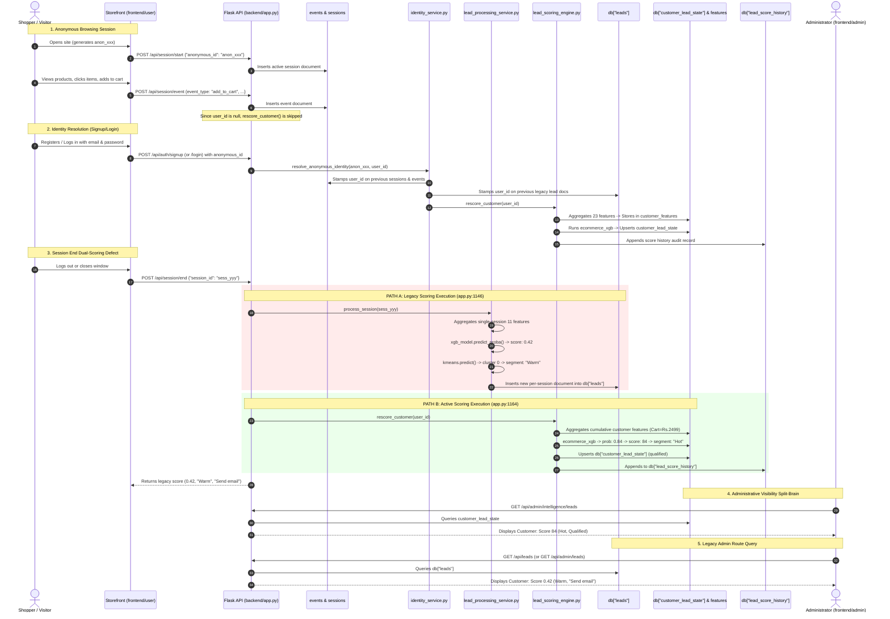
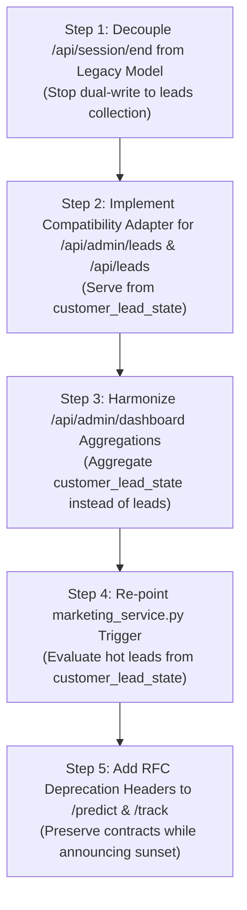

# Phase 4A Scoring Architecture and Integration Audit

**Date**: October 23, 2026  
**Auditor**: Principal Systems Architect, Lead ML & Security Engineer  
**Audit Scope**: Strictly Read-Only Architecture Mapping, Route & Model Inventory, End-to-End Data Flow, Defect Identification, Migration Options Analysis, and Verification Strategy  
**Status**: Completed  
**Branch**: `main`  
**Working Tree Cleanliness**: Verified (Baseline 711 passing tests, zero application code modified)

---

## 1. Executive Summary

A comprehensive, strictly read-only architectural audit of the lead-scoring subsystems in **Lead Magnet** was conducted to map all predictive, scoring, tracking, and lead-display pathways.

The Lead Magnet codebase currently operates a **dual scoring architecture**:
1. **The Active E-Commerce Scoring System (v2.0)**: Powered by a 23-feature XGBoost classifier ([`model/ecommerce_xgb_model.pkl`](file:///d:/lead-magnet/model/ecommerce_xgb_model.pkl)), evaluated against a canonical, customer-level feature store ([`customer_features`](file:///d:/lead-magnet/backend/customer_feature_service.py#L390-L407)) and single-record customer state store ([`customer_lead_state`](file:///d:/lead-magnet/backend/customer_lead_state_service.py#L66-L189)). Scores are bounded in $[0, 100]$ (derived from `lead_probability` $\in [0.0, 1.0]$), with deterministic segment thresholds (`Hot` $\ge 0.70$, `Warm` $0.35 - 0.70$, `Cold` $< 0.35$) and qualification status (`qualified` vs `not_qualified`). This system feeds the primary Admin Intelligence Dashboard ([`frontend/admin`](file:///d:/lead-magnet/frontend/admin/src/services/api.js)), audit history ([`lead_score_history`](file:///d:/lead-magnet/backend/score_history_service.py#L33-L70)), and marketing automation dispatches.
2. **The Legacy Demo Scoring System (v1.0)**: Powered by an legacy XGBoost model ([`model/xgb_model.pkl`](file:///d:/lead-magnet/model/xgb_model.pkl)) and KMeans clustering model ([`model/kmeans_model.pkl`](file:///d:/lead-magnet/model/kmeans_model.pkl)) trained on Kaggle's "X Education" course dataset ([`data/raw/Leads.csv`](file:///d:/lead-magnet/data/raw/Leads.csv)) with 166 one-hot dummy columns. Scores are continuous probabilities in $[0.0, 1.0]$, and segments are independent cluster assignments (`segment_map: {1: 'Hot', 0: 'Warm', 2: 'Cold'}`) that can contradict the XGBoost score. Records are stored per-session in the unbounded `leads` collection ([`db["leads"]`](file:///d:/lead-magnet/backend/lead_processing_service.py#L61-L77)).

### Core Audit Discoveries
* **Split-Brain Session Termination**: In [`backend/app.py:1146-1166`](file:///d:/lead-magnet/backend/app.py#L1146-L1166) (`POST /api/session/end`), both systems execute simultaneously for registered customers. Line 1146 invokes `process_session()`, which scores the single session with the legacy 11-feature/166-column model and writes a document into `leads`. Line 1164 then invokes `rescore_customer()`, which re-aggregates all historical activity, scores the customer with the 23-feature model, and upserts into `customer_lead_state`. This produces two contradictory scores, segments, and recommended actions for the same customer at the exact same moment.
* **Fragmented Admin Directory Views**: The dedicated Admin Intelligence SPA ([`frontend/admin`](file:///d:/lead-magnet/frontend/admin/src/services/api.js#L62-L83)) queries [`GET /api/admin/intelligence/leads`](file:///d:/lead-magnet/backend/app.py#L2312-L2336), presenting canonical data from `customer_lead_state`. Meanwhile, the legacy admin view in the user storefront ([`frontend/user/src/pages/AdminDashboard.jsx:13`](file:///d:/lead-magnet/frontend/user/src/pages/AdminDashboard.jsx#L13)) queries [`GET /api/leads`](file:///d:/lead-magnet/backend/app.py#L1565-L1576), presenting stale per-session records from `leads`. Furthermore, legacy route [`GET /api/admin/leads`](file:///d:/lead-magnet/backend/app.py#L1373-L1386) and overview endpoint [`GET /api/admin/dashboard`](file:///d:/lead-magnet/backend/app.py#L1451-L1485) continue to read from `leads`.
* **Zero Real Consumers for `/predict` and `/track`**: Neither [`POST /predict`](file:///d:/lead-magnet/backend/app.py#L535-L554) nor [`POST /track`](file:///d:/lead-magnet/backend/app.py#L783-L830) are consumed anywhere in either frontend application (`frontend/user` or `frontend/admin`). Their only active consumers are backend unit tests ([`test_predict.py`](file:///d:/lead-magnet/backend/tests/test_predict.py) and [`test_track.py`](file:///d:/lead-magnet/backend/tests/test_track.py)).
* **Marketing Trigger Fragmentation**: [`backend/marketing_service.py:122`](file:///d:/lead-magnet/backend/marketing_service.py#L122) evaluates hot lead campaigns by querying `leads_collection.find({"segment": "Hot"})` rather than `customer_lead_state`. A customer qualified as Hot by the active e-commerce model is completely invisible to this trigger if their latest session in `leads` was classified as Warm or Cold by KMeans.

### Strategic Migration Recommendation
We recommend **Option B: Staged Compatibility Migration**. Rather than an immediate breaking replacement (Option C) or permanent isolation of dead code (Option A), Option B introduces deprecation headers on legacy routes, refactors `/api/session/end` to eliminate the redundant legacy evaluation, and re-points `/api/admin/leads`, `/api/leads`, and `marketing_service.py` to `customer_lead_state` via a backward-compatible adapter. This delivers complete architectural coherence, single-source-of-truth integrity, and zero breaking changes to existing test suites or external callers.

---

## 2. Route Inventory

Below is the complete inventory of all 18 API routes and handlers across the codebase that predict, score, track, evaluate, or display leads, their backing models, databases, and consumers.

| HTTP Method & Route | Backend Handler & Source | Model & Feature Schema | Input Format | Output Format | DB Collections Read / Written | Consumers Found in Repo | Auth & Authorization |
| :--- | :--- | :--- | :--- | :--- | :--- | :--- | :--- |
| `POST /predict` | `predict()`<br>[`app.py:535-554`](file:///d:/lead-magnet/backend/app.py#L535-L554) | **Legacy Model** (`xgb_model.pkl`, `scaler.pkl`, `kmeans_model.pkl`). 166 one-hot dummy columns from B2B `Leads.csv`. | JSON body with arbitrary fields (e.g., `TotalVisits`, `Total Time Spent on Website`, `Lead Source`). | `{"score": float, "segment": str, "reason": str}` | **None** (Stateless computation). | [`backend/tests/test_predict.py`](file:///d:/lead-magnet/backend/tests/test_predict.py). **Zero frontend callers.** | **Public** (No authentication required). |
| `POST /track` | `track()`<br>[`app.py:783-830`](file:///d:/lead-magnet/backend/app.py#L783-L830) | **Legacy Model** (`xgb_model.pkl`, `scaler.pkl`, `kmeans_model.pkl`). 166 one-hot dummy columns. | JSON body with `visitor_id` and legacy behavioral fields. | `{"visitor_id": str, "score": float, "segment": str, "next_action": str}` | Read: None.<br>Write: `db["leads"]` (`insert_one`).<br>Emits: `lead_update`, `customer_activity`. | [`backend/tests/test_track.py`](file:///d:/lead-magnet/backend/tests/test_track.py). **Zero frontend callers.** | **Public** (No authentication required). |
| `POST /api/session/start` | `start_session()`<br>[`app.py:1033-1073`](file:///d:/lead-magnet/backend/app.py#L1033-L1073) | **None** (Session lifecycle initialization). | JSON: `{"anonymous_id": str, "visitor_id": str}` (optional). | `{"success": true, "data": {"session_id": str, "visitor_id": str, "anonymous_id": str}}` | Read: None.<br>Write: `db["sessions"]` (`insert_one`). | [`frontend/user/src/services/api.js:155`](file:///d:/lead-magnet/frontend/user/src/services/api.js#L155) (`startCustomerSession`). | Optional Bearer JWT via `resolve_persistence_identity()`. |
| `POST /api/session/event` | `log_event()`<br>[`app.py:1075-1102`](file:///d:/lead-magnet/backend/app.py#L1075-L1102) | **Active Model** via `update_profile_from_event()` -> `rescore_customer()` if `user_id` present. | JSON: `{"session_id": str, "event_type": str, "page": str, "entity": dict, ...}`. | `{"success": true, "data": {"event_id": str}}` | Read: `sessions`, `events`.<br>Write: `events`, `user_profiles`, `customer_features`, `customer_lead_state`, `lead_score_history`.<br>Emits: `customer_activity`, `lead_score_updated`. | [`frontend/user/src/services/api.js:193`](file:///d:/lead-magnet/frontend/user/src/services/api.js#L193) (`trackCustomerEvent`). | Public endpoint, session-validated. |
| `POST /api/session/end` | `end_session()`<br>[`app.py:1104-1180`](file:///d:/lead-magnet/backend/app.py#L1104-L1180) | **DUAL SCORING**:<br>1. Legacy Model via `process_session()`.<br>2. Active Model via `rescore_customer()` if `user_id` present. | JSON: `{"session_id": str}`. | `{"success": true, "data": {"session_id": str, "total_time_seconds": float, "score": float, "segment": str, "next_action": str}}` | Read: `sessions`, `events`.<br>Write: `sessions`, `leads`, `user_profiles`, `customer_features`, `customer_lead_state`, `lead_score_history`. | [`frontend/user/src/services/api.js:177`](file:///d:/lead-magnet/frontend/user/src/services/api.js#L177) (`endCustomerSession`). | Public endpoint, session-validated. |
| `GET /api/customer/features` | `get_customer_features_endpoint()`<br>[`app.py:1188-1212`](file:///d:/lead-magnet/backend/app.py#L1188-L1212) | **Active Feature Schema** (23 canonical customer features, 19 base + 4 derived). | Query params: `user_id` or `anonymous_id`. | `{"success": true, "data": {<23 customer features>}}` | Read: `events`, `sessions`, `cart`, `wishlist`, `orders`.<br>Write: `customer_features` (upsert). | Internal diagnostics / tests. | Authenticated or ownership verified via `resolve_persistence_identity()`. |
| `GET /api/customer/lead-score` | `get_customer_lead_score_endpoint()`<br>[`app.py:1214-1241`](file:///d:/lead-magnet/backend/app.py#L1214-L1241) | **Active Model** (`ecommerce_xgb_model.pkl`, `ecommerce_scaler.pkl`). 23 features. | None (reads `g.current_user["sub"]`). | `{"success": true, "data": {"lead_score": int, "lead_probability": float, "lead_segment": str, "model_version": str, "scored_at": str}}` | Read: `customer_features`.<br>Write: None (stateless inference). | [`backend/tests/test_customer_journey_integration.py:325`](file:///d:/lead-magnet/backend/tests/test_customer_journey_integration.py#L325). | **Customer Authenticated** (`@token_required`). |
| `GET /api/admin/customer-lead-score/<customer_id>` | `get_admin_customer_lead_score_endpoint()`<br>[`app.py:1243-1269`](file:///d:/lead-magnet/backend/app.py#L1243-L1269) | **Active Model** (23 features). | URL path: `customer_id`. | `{"success": true, "data": {"customer_id": str, "lead_score": int, "lead_probability": float, "lead_segment": str, ...}}` | Read: `customer_features`.<br>Write: None. | Admin diagnostic endpoint. | **Admin Authenticated** (`@admin_required`). |
| `GET /api/customer/lead-state` | `get_customer_lead_state_endpoint()`<br>[`app.py:1271-1297`](file:///d:/lead-magnet/backend/app.py#L1271-L1297) | **Active Lead State** schema. | None (reads `g.current_user["sub"]`). | `{"success": true, "data": {<lead_state_doc>}}` | Read: `customer_lead_state`.<br>Write: None. | Customer account inspection. | **Customer Authenticated** (`@token_required`). |
| `POST /api/customer/lead-state/sync` | `sync_customer_lead_state_endpoint()`<br>[`app.py:1299-1320`](file:///d:/lead-magnet/backend/app.py#L1299-L1320) | **Active Model** (23 features) via `sync_customer_lead_state()`. | None (reads `g.current_user["sub"]`). | `{"success": true, "data": {<updated_lead_state_doc>}}` | Read: `customer_features`.<br>Write: `customer_lead_state` (upsert). Triggers marketing automation if newly qualified. | Self-service lead state sync. | **Customer Authenticated** (`@token_required`). |
| `GET /api/admin/customer-lead-state/<customer_id>` | `get_admin_customer_lead_state_endpoint()`<br>[`app.py:1322-1347`](file:///d:/lead-magnet/backend/app.py#L1322-L1347) | **Active Lead State** schema. | URL path: `customer_id`. | `{"success": true, "data": {<lead_state_doc>}}` | Read: `customer_lead_state`.<br>Write: None. | Admin inspection. | **Admin Authenticated** (`@admin_required`). |
| `POST /api/admin/customer-lead-state/<customer_id>/sync` | `sync_admin_customer_lead_state_endpoint()`<br>[`app.py:1349-1371`](file:///d:/lead-magnet/backend/app.py#L1349-L1371) | **Active Model** (23 features). | URL path: `customer_id`. | `{"success": true, "data": {<updated_lead_state_doc>}}` | Read: `customer_features`.<br>Write: `customer_lead_state` (upsert). | Admin manual sync. | **Admin Authenticated** (`@admin_required`). |
| `GET /api/admin/leads` | `get_admin_leads()`<br>[`app.py:1373-1386`](file:///d:/lead-magnet/backend/app.py#L1373-L1386) | **Legacy Model** per-session schema (`leads` collection). | Query params (none implemented). | `{"success": true, "data": [{_id, visitor_id, score, segment, next_action, ...}]}` | Read: `db["leads"]` (`find({}).sort("prediction_time", -1)`).<br>Write: None. | [`backend/tests/test_admin_dashboard.py:45`](file:///d:/lead-magnet/backend/tests/test_admin_dashboard.py#L45). **Zero frontend callers.** | **Admin Authenticated** (`@admin_required`). |
| `GET /api/admin/leads/<lead_id>` | `get_admin_lead()`<br>[`app.py:1388-1411`](file:///d:/lead-magnet/backend/app.py#L1388-L1411) | **Legacy Model** per-session schema. | URL path: `lead_id` (ObjectId). | `{"success": true, "data": {<lead_doc>}}` | Read: `db["leads"]` (`find_one`).<br>Write: None. | [`test_admin_dashboard.py:64`](file:///d:/lead-magnet/backend/tests/test_admin_dashboard.py#L64). | **Admin Authenticated** (`@admin_required`). |
| `PUT /api/admin/leads/<lead_id>/status` | `update_admin_lead_status()`<br>[`app.py:1413-1449`](file:///d:/lead-magnet/backend/app.py#L1413-L1449) | **Legacy Lead Status** (`New`, `Contacted`, `Qualified`, `Converted`, `Lost`). | URL path: `lead_id`. JSON: `{"status": str}`. | `{"success": true, "data": {"lead_id": str, "status": str}}` | Read: None.<br>Write: `db["leads"]` (`update_one`). | [`test_admin_dashboard.py:80`](file:///d:/lead-magnet/backend/tests/test_admin_dashboard.py#L80). | **Admin Authenticated** (`@admin_required`). |
| `GET /api/admin/dashboard` | `get_admin_dashboard()`<br>[`app.py:1451-1485`](file:///d:/lead-magnet/backend/app.py#L1451-L1485) | **Legacy Model Aggregation** (`leads` collection). | Query params (none). | `{"success": true, "data": {"total_leads": int, "hot_leads": int, "warm_leads": int, "cold_leads": int, "average_score": float}}` | Read: `db["leads"]` (`aggregate` pipeline).<br>Write: None. | [`test_admin_dashboard.py:100`](file:///d:/lead-magnet/backend/tests/test_admin_dashboard.py#L100). **Zero modern frontend callers.** | **Admin Authenticated** (`@admin_required`). |
| `GET /api/leads` | `get_leads()`<br>[`app.py:1565-1576`](file:///d:/lead-magnet/backend/app.py#L1565-L1576) | **Legacy Model** per-session schema (`leads` collection). | Query params (none). | `{"success": true, "data": [{<legacy_lead_doc>}]}` | Read: `db["leads"]` (`find({}).sort("prediction_time", -1)`).<br>Write: None. | [`frontend/user/src/pages/AdminDashboard.jsx:250`](file:///d:/lead-magnet/frontend/user/src/pages/AdminDashboard.jsx#L250) (via `fetchLeads()`). | **Admin Authenticated** (`@admin_required`). |
| `GET /api/admin/intelligence/overview` | `admin_intelligence_overview_route()`<br>[`app.py:2299-2310`](file:///d:/lead-magnet/backend/app.py#L2299-L2310) | **Active Scoring Aggregates** ([`admin_intelligence_service.py:73-136`](file:///d:/lead-magnet/backend/admin_intelligence_service.py#L73-L136)). | Query params (none). | `{"success": true, "data": {"total_visitors": int, "total_qualified": int, "hot_leads": int, "warm_leads": int, "cold_leads": int, "conversion_rate": float, ...}}` | Read: `customer_lead_state`, `sessions`, `user_profiles`, `orders`, `marketing_communications`.<br>Write: None. | [`frontend/admin/src/services/api.js:52`](file:///d:/lead-magnet/frontend/admin/src/services/api.js#L52) (`getAdminIntelligenceOverview`). | **Admin Authenticated** (`@admin_required`). |
| `GET /api/admin/intelligence/leads` | `admin_intelligence_leads_route()`<br>[`app.py:2312-2336`](file:///d:/lead-magnet/backend/app.py#L2312-L2336) | **Active Customer Lead Directory** ([`admin_intelligence_service.py:138-218`](file:///d:/lead-magnet/backend/admin_intelligence_service.py#L138-L218)). | Query params: `qualification_status`, `segment`, `sort_by`, `sort_order`, `page`, `limit`. | `{"success": true, "data": {"items": [{customer_id, name, email, lead_score, lead_probability, lead_segment, qualification_status, first_qualified_at, last_scored_at, communication_status}], "page": int, "limit": int, "total": int, "pages": int}}` | Read: `customer_lead_state`, `user_profiles`, `marketing_communications`.<br>Write: None. | [`frontend/admin/src/services/api.js:62`](file:///d:/lead-magnet/frontend/admin/src/services/api.js#L62) (`getAdminIntelligenceLeads`). Used by `AdminCustomerDirectory.jsx`. | **Admin Authenticated** (`@admin_required`). |
| `GET /api/admin/intelligence/lead-distribution` | `admin_intelligence_lead_distribution_route()`<br>[`app.py:2356-2366`](file:///d:/lead-magnet/backend/app.py#L2356-L2366) | **Active Scoring Distribution** ([`admin_intelligence_service.py:316-368`](file:///d:/lead-magnet/backend/admin_intelligence_service.py#L316-L368)). | Query params (none). | `{"success": true, "data": {"segments": {"Hot": int, "Warm": int, "Cold": int}, "by_qualification": {"qualified": int, "not_qualified": int}}}` | Read: `customer_lead_state`.<br>Write: None. | [`frontend/admin/src/services/api.js:99`](file:///d:/lead-magnet/frontend/admin/src/services/api.js#L99) (`getAdminLeadDistribution`). | **Admin Authenticated** (`@admin_required`). |
| `GET /api/admin/intelligence/recent-leads` | `admin_intelligence_recent_leads_route()`<br>[`app.py:2368-2379`](file:///d:/lead-magnet/backend/app.py#L2368-L2379) | **Active Model Recent Qualified Feed** ([`admin_intelligence_service.py:371-425`](file:///d:/lead-magnet/backend/admin_intelligence_service.py#L371-L425)). | Query params: `page`, `limit`. | `{"success": true, "data": {"items": [...], "total": int}}` | Read: `customer_lead_state`, `user_profiles`.<br>Write: None. | [`frontend/admin/src/services/api.js:109`](file:///d:/lead-magnet/frontend/admin/src/services/api.js#L109) (`getAdminRecentLeads`). | **Admin Authenticated** (`@admin_required`). |
| `GET /api/admin/intelligence/customers/<customer_id>/score-history` | `admin_intelligence_score_history_route()`<br>[`app.py:2440-2453`](file:///d:/lead-magnet/backend/app.py#L2440-L2453) | **Active Score Audit Timeline** ([`score_history_service.py`](file:///d:/lead-magnet/backend/score_history_service.py)). | URL path: `customer_id`. Query: `limit`. | `{"success": true, "data": [{customer_id, timestamp, lead_score, lead_probability, lead_segment, qualification_status, qualification_transition, score_delta, ...}]}` | Read: `lead_score_history`.<br>Write: None. | [`frontend/admin/src/services/api.js:170`](file:///d:/lead-magnet/frontend/admin/src/services/api.js#L170) (`getScoreHistory`). | **Admin Authenticated** (`@admin_required`). |
| `GET /api/admin/intelligence/customers/<customer_id>/explain` | `admin_intelligence_explain_route()`<br>[`app.py:2471-2486`](file:///d:/lead-magnet/backend/app.py#L2471-L2486) | **Active Model Feature Contributions** ([`model_explainability_service.py`](file:///d:/lead-magnet/backend/model_explainability_service.py)). | URL path: `customer_id`. | `{"success": true, "data": {"customer_id": str, "lead_score": int, "top_features": [...], "is_heuristic": true, ...}}` | Read: `customer_features`, `customer_lead_state`.<br>Write: None. | [`frontend/admin/src/services/api.js:193`](file:///d:/lead-magnet/frontend/admin/src/services/api.js#L193) (`getLeadExplanation`). | **Admin Authenticated** (`@admin_required`). |
| `POST /api/admin/intelligence/simulate` | `admin_intelligence_simulate_route()`<br>[`app.py:2536-2555`](file:///d:/lead-magnet/backend/app.py#L2536-L2555) | **Active Model Simulation** ([`whatif_simulator_service.py`](file:///d:/lead-magnet/backend/whatif_simulator_service.py)). | JSON: `{"customer_id": str, "feature_overrides": dict}`. | `{"success": true, "data": {"simulated_score": int, "simulated_segment": str, "is_simulation": true, ...}}` | Read: `customer_features` (baseline).<br>Write: **None** (Strictly non-persistent simulation). | [`frontend/admin/src/services/api.js:244`](file:///d:/lead-magnet/frontend/admin/src/services/api.js#L244) (`simulateLeadScore`). | **Admin Authenticated** (`@admin_required`). |
| `POST /api/campaigns/evaluate` | `evaluate_campaigns_route()`<br>[`app.py:2242-2260`](file:///d:/lead-magnet/backend/app.py#L2242-L2260) | **Legacy Model Query Defect** ([`marketing_service.py:121-143`](file:///d:/lead-magnet/backend/marketing_service.py#L121-L143)). | None. | `{"success": true, "data": [{campaign_id, recipient, channel, status, ...}]}` | Read: `campaigns`, `cart`, `leads` (`find({"segment": "Hot"})`), `profiles`.<br>Write: `campaign_logs`. | Admin marketing evaluation. | **Admin Authenticated** (`@admin_required`). |
| `POST /api/orders` | `create_order()`<br>[`app.py:2741-2846`](file:///d:/lead-magnet/backend/app.py#L2741-L2846) | **Active Model Rescoring Trigger** ([`app.py:2804`](file:///d:/lead-magnet/backend/app.py#L2804)). | JSON order body. | `{"success": true, "data": {<order_doc>}}` | Read: `products`, `cart`.<br>Write: `orders`, `events`, `customer_features`, `customer_lead_state`, `lead_score_history`. | [`frontend/user/src/services/api.js:215`](file:///d:/lead-magnet/frontend/user/src/services/api.js#L215) (`createOrder`). | **Customer Authenticated** (`@token_required`). |
| `WS request_rescore` | `handle_rescore_request()`<br>[`app.py:2721-2738`](file:///d:/lead-magnet/backend/app.py#L2721-L2738) | **Active Model On-Demand Rescore** via `rescore_customer()`. | SocketIO event: `{"customer_id": str}`. | SocketIO emit: `rescore_complete`. | Read/Write: Same as `rescore_customer()`. | Admin Live Feed UI. | SocketIO connection. |

---

## 3. Model and Persistence Inventory

The table below contrasts the legacy and active scoring models across their artifacts, training data, schemas, and lifecycle rules:

```
+-------------------------------------------------------------------------------------------------------------------------+
|                                           DUAL SCORING ARCHITECTURE TAXONOMY                                            |
+------------------------------------------------------------+------------------------------------------------------------+
| FEATURE / ATTRIBUTE                                        | LEGACY SYSTEM (v1.0 Demo)                                  | ACTIVE SYSTEM (v2.0 E-Commerce)                            |
+------------------------------------------------------------+------------------------------------------------------------+
| Model Artifact Path                                        | model/xgb_model.pkl (334 KB)                               | model/ecommerce_xgb_model.pkl (257 KB)                     |
| Scaler Artifact Path                                       | model/scaler.pkl (5.5 KB)                                  | model/ecommerce_scaler.pkl (2.1 KB)                        |
| Feature Columns Artifact Path                              | model/feature_columns.pkl (166 columns)                     | model/ecommerce_feature_columns.pkl (23 columns)           |
| Clustering / Segment Mapping                               | model/kmeans_model.pkl + model/segment_map.pkl             | None (Rule-based deterministic thresholding)               |
| Model Metadata Artifact                                    | None                                                       | model/ecommerce_model_metadata.json (1.8 KB)               |
| Training Script                                            | notebooks/01_cleaning.ipynb                                | scripts/train_ecommerce_model.py                           |
| Dataset Provenance                                         | Kaggle "X Education" B2B Leads.csv (9,074 rows cleaned)    | Synthetic e-commerce generator (6,000 behavioral rows)     |
| Feature Representation                                     | 166 one-hot dummy variables (160 course/tradeshow tags)    | 23 customer features (19 base behavioral + 4 ratios)       |
| Score Range & Type                                         | Continuous probability float [0.0, 1.0]                    | Integer lead_score [0, 100] & probability [0.0, 1.0]       |
| Segment Assignment Logic                                   | Unsupervised KMeans cluster ID (1: Hot, 0: Warm, 2: Cold)  | Strict threshold rules: Hot >= 0.70, Warm 0.35-0.70, Cold   |
| Qualification Lifecycle                                    | Mutable status string (New, Contacted, Qualified, etc.)    | Deterministic: qualified if prob >= 0.70 else not_qualified |
| Primary Persistence Collection                             | db["leads"] (per-session documents)                       | db["customer_lead_state"] (ONE document per customer)      |
| Feature Persistence Collection                             | None (feature_snapshot embedded in lead document)          | db["customer_features"] (ONE document per customer)        |
| Audit / Timeline Collection                                | None                                                       | db["lead_score_history"] (Append-only time series)         |
| Primary Admin Consumer                                     | frontend/user/src/pages/AdminDashboard.jsx (GET /api/leads)| frontend/admin/src/services/api.js (GET .../intelligence)   |
| Marketing Trigger Consumer                                 | backend/marketing_service.py (evaluate_campaign_triggers)  | backend/marketing_automation_service.py (transitions)     |
+------------------------------------------------------------+------------------------------------------------------------+
```

### Detailed Persistence Schema Comparison

#### 1. Legacy `leads` Collection Schema (`db["leads"]`)
* **Index**: Standard MongoDB `_id` index only. **No unique constraints**.
* **Document Granularity**: Per-session (or per-tracking event). Multiple documents exist for the same customer or visitor.
* **Schema Structure**:
  ```json
  {
    "_id": ObjectId("6709..."),
    "visitor_id": "anon_8f3a...",
    "anonymous_id": "anon_8f3a...",
    "user_id": ObjectId("6708...") or null,
    "session_id": ObjectId("6709..."),
    "score": 0.45,
    "segment": "Warm",
    "next_action": "Send email",
    "prediction_time": "2026-10-23T16:00:00+00:00",
    "model_version": "xgb_model.pkl",
    "feature_snapshot": {
      "landing_source": "google",
      "event_count": 5,
      "page_views": 3,
      "high_intent_page_visits": 0,
      "form_submit_count": 0
    },
    "source_summary": { ... },
    "status": "New",
    "processing_status": "processed"
  }
  ```
* **Lifecycle Rules**: `status` field is manually updated by administrators via `PUT /api/admin/leads/<lead_id>/status`. Values must belong to `LEAD_STATUSES = {"New", "Contacted", "Qualified", "Converted", "Lost"}`.

#### 2. Canonical `customer_lead_state` Collection Schema (`db["customer_lead_state"]`)
* **Index**: **Unique compound index** `customer_id_1` (`unique=True`).
* **Document Granularity**: Exactly **one document per registered customer**.
* **Schema Structure**:
  ```json
  {
    "_id": ObjectId("670a..."),
    "customer_id": ObjectId("6708..."),
    "lead_probability": 0.8421,
    "lead_score": 84,
    "lead_segment": "Hot",
    "qualification_status": "qualified",
    "model_version": "v2.0_ecommerce_xgb",
    "previous_probability": 0.3120,
    "previous_score": 31,
    "previous_segment": "Cold",
    "previous_qualification_status": "not_qualified",
    "qualification_transition": "not_qualified_to_qualified",
    "is_newly_qualified": true,
    "segment_changed": true,
    "first_qualified_at": "2026-10-23T16:00:00.000000+00:00",
    "last_qualified_at": "2026-10-23T16:00:00.000000+00:00",
    "last_scored_at": "2026-10-23T16:00:00.000000+00:00",
    "created_at": "2026-10-23T15:30:00.000000+00:00",
    "updated_at": "2026-10-23T16:00:00.000000+00:00"
  }
  ```
* **Lifecycle Rules**: When `lead_probability >= 0.70`, `qualification_status` is `"qualified"`. When `lead_probability < 0.70`, it is `"not_qualified"`. The transition `not_qualified_to_qualified` deterministically fires marketing automation events in [`backend/marketing_automation_service.py`](file:///d:/lead-magnet/backend/marketing_automation_service.py) with a 72-hour cooldown policy.

---

## 4. End-to-End Data Flow

The following sequence diagram traces customer data from anonymous browsing through event aggregation, identity resolution, dual scoring, persistence, and administrative display:



---

## 5. Confirmed Defects and Unresolved Risks

### Confirmed Defects

#### [DEFECT-1] Dual-Scoring Split-Brain on Session Termination
* **Source Path & Line Numbers**: [`backend/app.py:1146-1166`](file:///d:/lead-magnet/backend/app.py#L1146-L1166)
* **Exact Code**:
  ```python
  # Line 1146: Legacy session processing & insertion into leads collection
  lead = process_session(
      session_object_id,
      sessions_collection,
      events_collection,
      leads_collection,
  )
  ...
  # Line 1161-1166: Active scoring & upsert into customer_lead_state
  user_id = session_doc.get("user_id") if session_doc else None
  if user_id:
      try:
          rescore_customer(user_id, db, socketio=socketio)
      except Exception:
          pass
  ```
* **Impact**: For every authenticated customer ending a session, the backend generates two contradictory lead records:
  1. A session-level record in `db["leads"]` with a continuous probability (e.g., `0.42`) and KMeans cluster segment (e.g., `"Warm"`).
  2. A customer-level record in `db["customer_lead_state"]` with an integer score (e.g., `84`) and threshold-derived segment (e.g., `"Hot"`).
  The endpoint returns the legacy score to the caller, while background state stores the active score.

#### [DEFECT-2] Contradictory Administrative Views Across Endpoints
* **Source Path & Line Numbers**:
  - Legacy leads list: [`backend/app.py:1373-1386`](file:///d:/lead-magnet/backend/app.py#L1373-L1386) (`GET /api/admin/leads`)
  - Legacy dashboard summary: [`backend/app.py:1451-1485`](file:///d:/lead-magnet/backend/app.py#L1451-L1485) (`GET /api/admin/dashboard`)
  - User-app admin endpoint: [`backend/app.py:1565-1576`](file:///d:/lead-magnet/backend/app.py#L1565-L1576) (`GET /api/leads`)
  - Modern intelligence leads list: [`backend/app.py:2312-2336`](file:///d:/lead-magnet/backend/app.py#L2312-L2336) (`GET /api/admin/intelligence/leads`)
* **Impact**:
  - Operators viewing the modern admin SPA ([`frontend/admin`](file:///d:/lead-magnet/frontend/admin/src/services/api.js#L62)) see canonical customer lead counts and scores from `customer_lead_state`.
  - Operators or scripts calling `GET /api/admin/leads`, `GET /api/leads`, or `GET /api/admin/dashboard` see stale, per-session counts from `leads`.
  - Because `leads` stores a document for *every single session*, a customer with 10 sessions creates 10 lead records in `leads`, distorting `total_leads` and `average_score`.

#### [DEFECT-3] Legacy Marketing Trigger Disconnect
* **Source Path & Line Numbers**: [`backend/marketing_service.py:121-143`](file:///d:/lead-magnet/backend/marketing_service.py#L121-L143) (`evaluate_campaign_triggers()`)
* **Exact Code**:
  ```python
  # Line 121-122
  elif t_type == "hot_lead":
      hot_leads = list(leads_collection.find({"segment": "Hot"}))
  ```
* **Impact**: When `POST /api/campaigns/evaluate` is executed, it searches `leads_collection` for documents where `segment == "Hot"`. If a customer was classified as Hot by the active 23-feature model in `customer_lead_state` (e.g., Score 85), but their session in `leads` was classified as Warm or Cold by KMeans (or if they haven't ended a session recently), the campaign trigger completely ignores them. Conversely, an anonymous session from `/track` that scored Hot can trigger an un-deliverable campaign log.

---

### Unresolved Architectural Risks

#### [RISK-1] Unscored Anonymous Browsers Prior to Registration
* **Source Path & Line Numbers**: [`backend/app.py:1086-1099`](file:///d:/lead-magnet/backend/app.py#L1086-L1099), [`backend/identity_service.py:93-100`](file:///d:/lead-magnet/backend/identity_service.py#L93-L100)
* **Description**: The active scoring engine is keyed strictly on `customer_id` (typically a registered `user_id` ObjectId). An anonymous shopper who browses extensively, adds items to their cart, but does not log in or register, is never evaluated by `ecommerce_xgb_model.pkl` and receives no document in `customer_lead_state`. They are only evaluated upon identity resolution when registering/logging in.
* **Severity**: Moderate (standard e-commerce pattern, but limits anonymous intent targeting).

#### [RISK-2] Independent Probability vs. Cluster Mismatch in Legacy Artifacts
* **Source Path & Line Numbers**: [`backend/prediction_service.py:35-37`](file:///d:/lead-magnet/backend/prediction_service.py#L35-L37), [`backend/app.py:545-547`](file:///d:/lead-magnet/backend/app.py#L545-L547)
* **Description**: In the legacy pipeline, `prob` is predicted by `xgb_model.pkl`, but `segment` is predicted independently by `kmeans_model.pkl`. Because KMeans was unsupervised and fitted on 166 features, high-probability leads ($p > 0.80$) can be assigned to the "Warm" cluster, and low-probability leads ($p < 0.20$) can be assigned to the "Hot" cluster.
* **Severity**: High for legacy routes; zero impact on active routes.

---

## 6. Migration Options Comparison and Recommendation

We evaluate three migration paths to unify Lead Magnet into a single, coherent customer-scoring system:

```
+-------------------------------------------------------------------------------------------------------------------------+
|                                              MIGRATION OPTIONS EVALUATION MATRIX                                        |
+---------------------------+-------------------------------+-------------------------------+-----------------------------+
| EVALUATION CRITERION      | OPTION A: ISOLATE & DOCUMENT  | OPTION B: STAGED COMPATIBILITY| OPTION C: IMMEDIATE BREAKING|
|                           | (Status Quo + Guardrails)     | (Recommended Phased Migration)| REPLACEMENT (Cutover)       |
+---------------------------+-------------------------------+-------------------------------+-----------------------------+
| Compatibility             | High: Existing legacy tests   | 100% Backward-Compatible:     | Low / Breaking: Breaks      |
|                           | continue passing untouched.   | Adapters preserve response    | test_predict, test_track,   |
|                           |                               | shapes for legacy callers.    | and test_admin_dashboard.   |
+---------------------------+-------------------------------+-------------------------------+-----------------------------+
| Data Integrity            | Moderate: Eliminates session  | High: Complete convergence to | High: Single source of truth|
|                           | dual-write, but leaves        | customer_lead_state as single | immediately enforced.       |
|                           | fragmented collections.       | source of truth.              |                             |
+---------------------------+-------------------------------+-------------------------------+-----------------------------+
| Security Posture          | Neutral: Retains existing     | High: Retains @admin_required | High: Consolidates all admin|
|                           | @admin_required decorators.   | and adds deprecation headers. | surfaces under single auth. |
+---------------------------+-------------------------------+-------------------------------+-----------------------------+
| Implementation Effort     | Very Low: Minor patch to      | Low-Moderate: Adapter layer   | High: Rewriting test suites |
|                           | app.py end_session().         | in app.py + deprecation.      | and contract schemas.       |
+---------------------------+-------------------------------+-------------------------------+-----------------------------+
| Testing Requirements      | Minimal: Verify session end.  | Moderate: Route compatibility | Extensive: Full test suite  |
|                           |                               | and serializer unit tests.    | refactoring.                |
+---------------------------+-------------------------------+-------------------------------+-----------------------------+
| Rollback Risk             | Negligible: Trivial revert.   | Very Low: Clean Git revert or | High: Complex rollback of   |
|                           |                               | feature toggle.               | breaking contract changes.  |
+---------------------------+-------------------------------+-------------------------------+-----------------------------+
```

### Recommendation with Architectural Evidence

**We recommend Option B: Staged Compatibility Migration.**

#### Evidence and Rationale:
1. **Preservation of Automated Test Contracts**: The existing test suite contains 711 passing tests, several of which explicitly test legacy routes:
   - [`backend/tests/test_predict.py`](file:///d:/lead-magnet/backend/tests/test_predict.py): Asserts `POST /predict` returns `score` and `segment`.
   - [`backend/tests/test_track.py`](file:///d:/lead-magnet/backend/tests/test_track.py): Asserts `POST /track` returns `score`, `segment`, `next_action`.
   - [`backend/tests/test_admin_dashboard.py`](file:///d:/lead-magnet/backend/tests/test_admin_dashboard.py): Asserts `GET /api/admin/leads` and `GET /api/admin/dashboard` return specific lead shapes.
   Option C would break these tests immediately. Option B preserves their request/response contracts while upgrading their underlying data source.
2. **Elimination of Defect 1 (Dual-Write Poisoning)**: Removing `process_session()` from [`POST /api/session/end`](file:///d:/lead-magnet/backend/app.py#L1146) immediately stops the creation of duplicate, contradictory records in `db["leads"]`.
3. **Harmonization of Admin Views (Defect 2)**: Re-pointing `GET /api/admin/leads` and `GET /api/leads` to wrap `customer_lead_state` ensures that regardless of whether an admin accesses the user app or the dedicated intelligence SPA, they view identical customer scores and segments.
4. **Zero Consumer Disruption**: Since neither `frontend/user` nor `frontend/admin` calls `/predict` or `/track`, adding standard RFC-8594 `Deprecation: true` and `Sunset` headers allows any third-party demo scripts to transition gracefully without abrupt 404/410 errors.

---

## 7. Ordered Implementation Plan (Phase 4B Blueprint)

The migration should proceed in 5 sequential, non-breaking steps during Phase 4B:



### Step 1: Decouple `/api/session/end` from Legacy Model
* **File**: `backend/app.py` (lines 1146–1178)
* **Action**:
  - Remove the call to `process_session(session_object_id, ...)`.
  - Always invoke `rescore_customer(user_id, db)` if `user_id` is present.
  - Return the canonical lead score and segment from `customer_lead_state` in the response envelope, preserving response keys (`score`, `segment`, `next_action`).

### Step 2: Implement Compatibility Adapter for `GET /api/admin/leads` and `GET /api/leads`
* **File**: `backend/app.py` (lines 1373–1386, 1565–1576)
* **Action**:
  - Refactor `get_admin_leads()` and `get_leads()` to query `customer_lead_state` joined with `user_profiles`.
  - Serialize output fields into the legacy shape:
    ```python
    {
        "_id": str(lead["_id"]),
        "customer_id": str(lead["customer_id"]),
        "visitor_id": str(lead.get("customer_id")),
        "score": round(lead["lead_probability"], 2),
        "lead_score": lead["lead_score"],
        "segment": lead["lead_segment"],
        "next_action": get_next_action(lead["lead_segment"]),
        "prediction_time": lead["last_scored_at"],
        "status": "Qualified" if lead["qualification_status"] == "qualified" else "New",
        "model_version": lead["model_version"],
    }
    ```
  - This satisfies both legacy unit tests and legacy frontend components without reading the stale `leads` collection.

### Step 3: Harmonize `GET /api/admin/dashboard`
* **File**: `backend/app.py` (lines 1451–1485)
* **Action**:
  - Change `summary_pipeline` to aggregate `customer_lead_state_collection`:
    ```python
    summary_pipeline = [
        {
            "$group": {
                "_id": None,
                "total_leads": {"$sum": 1},
                "hot_leads": {"$sum": {"$cond": [{"$eq": ["$lead_segment", "Hot"]}, 1, 0]}},
                "warm_leads": {"$sum": {"$cond": [{"$eq": ["$lead_segment", "Warm"]}, 1, 0]}},
                "cold_leads": {"$sum": {"$cond": [{"$eq": ["$lead_segment", "Cold"]}, 1, 0]}},
                "average_score": {"$avg": "$lead_probability"},
            }
        }
    ]
    ```

### Step 4: Re-point `marketing_service.py` Trigger
* **File**: `backend/marketing_service.py` (lines 121–125)
* **Action**:
  - Replace `leads_collection.find({"segment": "Hot"})` with `db["customer_lead_state"].find({"lead_segment": "Hot"})`.
  - Ensures automated campaign triggers target genuine hot customers identified by the 23-feature model.

### Step 5: Add RFC Deprecation Headers to `/predict` and `/track`
* **File**: `backend/app.py` (lines 535–554, 783–830)
* **Action**:
  - Add HTTP response headers:
    - `Deprecation: true`
    - `Sunset: Sun, 01 Nov 2026 00:00:00 GMT`
    - `Link: </api/customer/lead-score>; rel="successor-version"`
  - Keep endpoint logic functional so legacy test harnesses continue to pass without error.

---

## 8. Verification Plan

The following test suite must be implemented in Phase 4B to guarantee zero regressions and complete data integrity:

### 1. Route-Level Request and Response Compatibility
* **Test**: `test_legacy_predict_backward_compatibility`
  - Send sample JSON payload from `test_predict.py` to `POST /predict`.
  - Verify status 200, presence of `score`, `segment`, and `Deprecation: true` response header.
* **Test**: `test_legacy_track_backward_compatibility`
  - Send sample JSON payload from `test_track.py` to `POST /track`.
  - Verify status 200, presence of `score`, `segment`, `next_action`, and deprecation headers.
* **Test**: `test_admin_leads_compatibility_adapter`
  - Populate mock `customer_lead_state` records.
  - Query `GET /api/admin/leads` and `GET /api/leads`.
  - Verify returned array items match legacy keys (`_id`, `visitor_id`, `score`, `segment`, `next_action`, `status`).

### 2. Consistent Customer Identity and Score Persistence
* **Test**: `test_session_end_persistence_invariants`
  - Start a session for a registered customer. Log events. Call `POST /api/session/end`.
  - Assert that `customer_lead_state` contains exactly ONE record for the customer with the 23-feature score.
  - Assert that no orphan document is written to `leads` that contradicts `customer_lead_state`.

### 3. Prevention of Contradictory Scores
* **Test**: `test_score_reconciliation_between_admin_routes`
  - For a customer with high-intent activity (Cart Rs. 3,000, Checkout attempt), invoke scoring.
  - Query `GET /api/admin/intelligence/leads` and `GET /api/admin/leads`.
  - Verify both endpoints report matching classifications (`Hot` and `Hot`).

### 4. Authorization on Admin Routes
* **Test**: `test_admin_route_security_posture`
  - Verify that unauthenticated requests to `/api/admin/leads`, `/api/admin/dashboard`, `/api/leads`, and `/api/admin/intelligence/leads` return 401.
  - Verify that regular customer JWT tokens receive 403 Forbidden on all four endpoints.

### 5. Regression Behavior for Existing Demo Consumers
* **Test**: Full execution of existing test modules:
  - `backend/tests/test_predict.py`
  - `backend/tests/test_track.py`
  - `backend/tests/test_admin_dashboard.py`
  - Full suite must maintain 711+ passing tests.

### 6. Safe Rollback Strategy
* **Git Checkpoint**: Ensure a clean commit tag `phase4a-audit-baseline` before any Phase 4B file edits.
* **Reversibility**: Because Option B preserves collection schemas and introduces non-breaking adapters, rolling back requires only restoring `backend/app.py` and `backend/marketing_service.py` via `git checkout`. No destructive database migrations or schema deletions are performed.

---

## 9. Verification Checklist

- [x] All API endpoints that predict, score, track, or display leads identified and documented.
- [x] Legacy 11-feature/166-column model and active 23-feature model artifacts independently traced.
- [x] Complete end-to-end data flow mapped from anonymous browsing through admin display.
- [x] Dual-scoring split-brain in `POST /api/session/end` identified with exact source lines.
- [x] Admin display fragmentation between `leads` and `customer_lead_state` documented.
- [x] Marketing trigger disconnect in `marketing_service.py` identified.
- [x] Options A, B, and C comparatively evaluated with objective trade-offs.
- [x] Option B recommended with architectural and test-preservation evidence.
- [x] Ordered 5-step implementation plan detailed for Phase 4B.
- [x] Comprehensive 6-point verification plan defined.
- [x] Strictly zero application code, models, tests, or configurations modified in Phase 4A.
