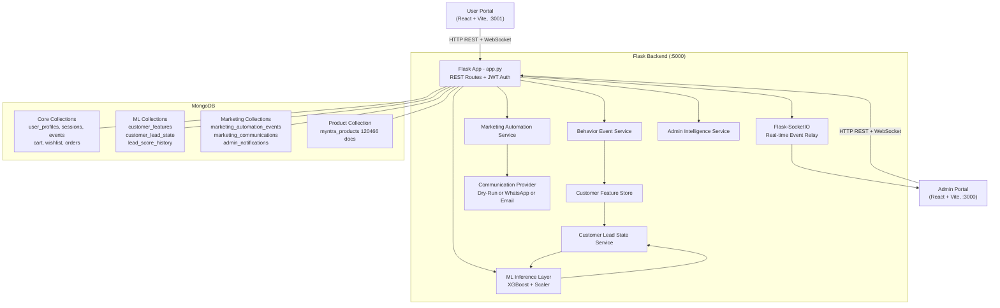
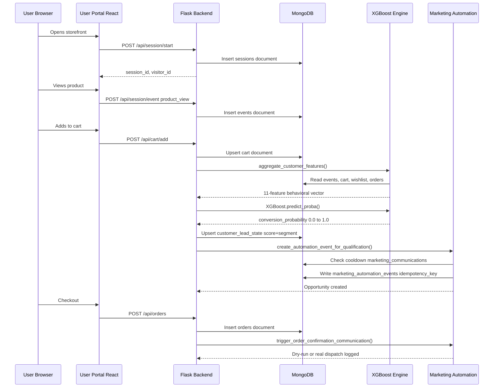
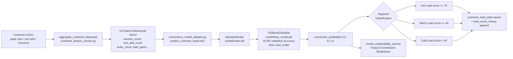
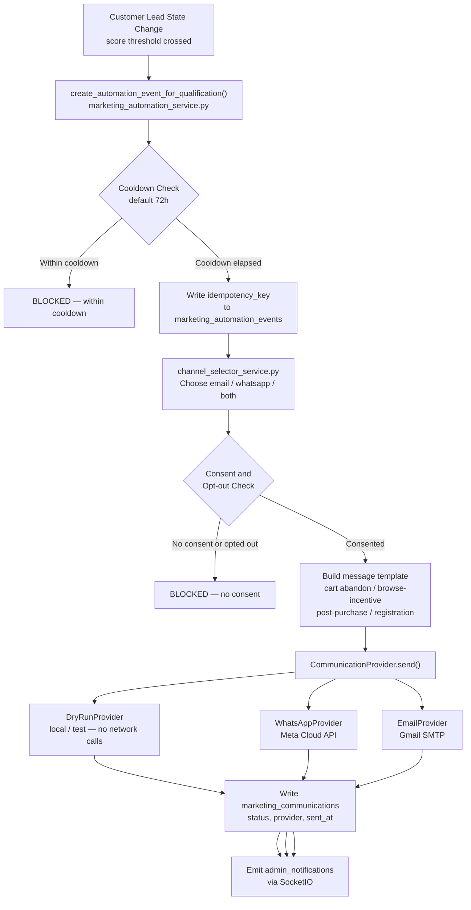
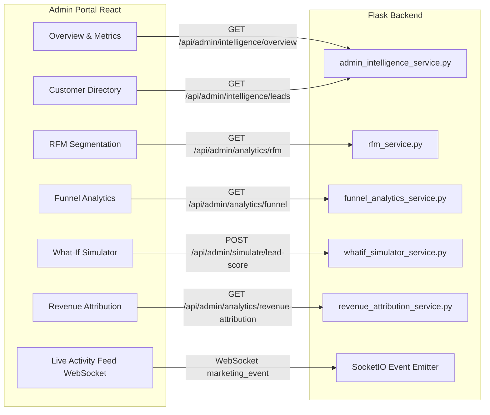
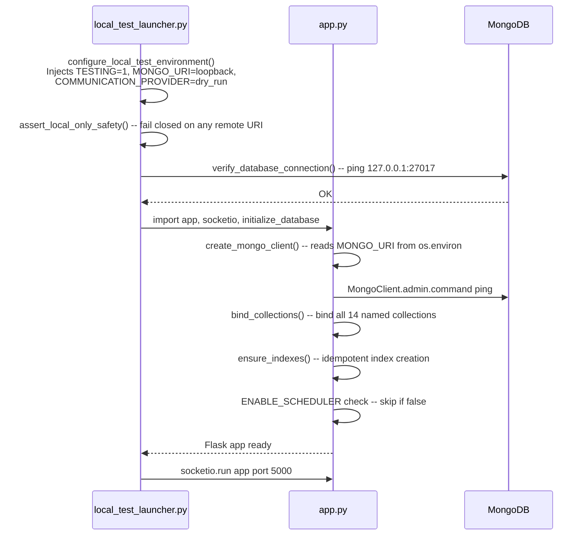
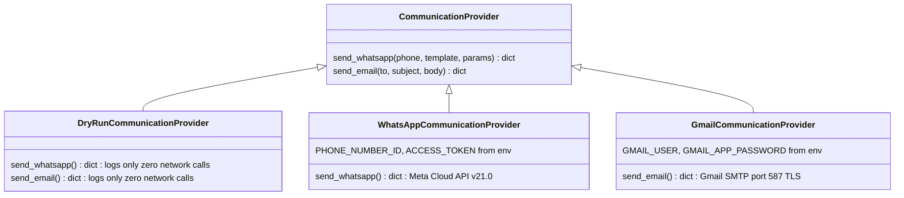
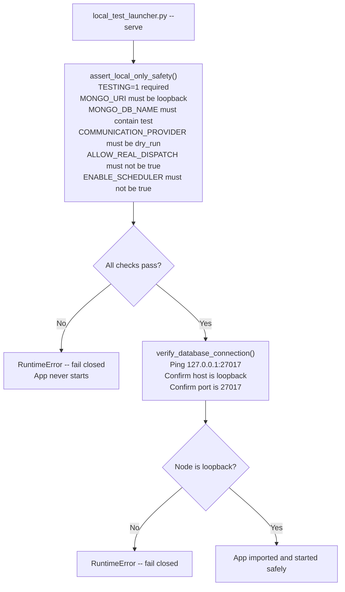

# Lead Magnet — Architecture and Data Flow Reference

> **Scope:** Authoritative technical reference for the Lead Magnet platform as of Task 24 (October 2026). All diagrams are derived from direct inspection of `backend/app.py`, service modules, and verified against the Task 23 local acceptance test results (678/678 tests passing).

---

## 1. System Overview

Lead Magnet is a full-stack AI-powered Customer Intelligence Platform consisting of three independently-deployable tiers:

| Tier | Technology | Role |
|:--|:--|:--|
| **User Portal** | React 18 + Vite | Customer-facing e-commerce storefront |
| **Admin Portal** | React 18 + Vite | Internal intelligence & analytics dashboard |
| **Backend API** | Flask + Flask-SocketIO | REST API, WebSocket relay, ML inference, automation |
| **Database** | MongoDB (Atlas in production / `127.0.0.1:27017` for local demo) | Persistent document store for all collections |
| **ML Engine** | XGBoost + Scikit-Learn (offline-trained, serialized) | Real-time lead scoring inference |

---

## 2. High-Level System Architecture

---

## 3. Request Lifecycle — End-to-End Sequence

---

## 4. ML Lead Scoring Pipeline

### 11 Behavioral Features Fed to XGBoost

| # | Feature | Source |
|:--|:--|:--|
| 1 | `session_count` | sessions collection |
| 2 | `page_view_count` | events collection |
| 3 | `cart_add_count` | cart collection |
| 4 | `wishlist_add_count` | wishlist collection |
| 5 | `order_count` | orders collection |
| 6 | `total_spent` | orders collection |
| 7 | `avg_order_value` | computed from orders |
| 8 | `days_since_last_active` | user_profiles |
| 9 | `engagement_score` | computed composite |
| 10 | `search_count` | events collection |
| 11 | `checkout_attempt_count` | events collection |

---

## 5. Marketing Automation Pipeline

### Communication Trigger Events

| Trigger Function | Fired When |
|:--|:--|
| `trigger_registration_communication()` | User completes signup |
| `trigger_cart_abandonment_communication()` | Cart add + no checkout within threshold |
| `trigger_wishlist_reminder_communication()` | Wishlist items not purchased |
| `trigger_order_confirmation_communication()` | Successful order placed |
| `create_automation_event_for_qualification()` | Lead score crosses Hot/Warm threshold |

---

## 6. Identity Resolution Flow

```mermaid
flowchart LR
    A["Anonymous Visit<br/>no account"]
    B["generate_anonymous_id()<br/>identity_service.py"]
    C["session started with visitor_id"]
    D["Events logged under visitor_id"]
    E["User Registers / Logs In"]
    F["resolve_anonymous_identity()<br/>identity_service.py"]
    G["visitor_id -> user_id link stored"]
    H["All prior events backfilled<br/>to authenticated user_id"]
    I["Unified 360 degree Profile Available"]

    A --> B --> C --> D --> E --> F --> G --> H --> I
```

---

## 7. Admin Portal Real-Time Data Flow

---

## 8. Database Collections Reference

| Collection | Purpose | Key Indexes |
|:--|:--|:--|
| `user_profiles` | Authenticated customer profiles, consent flags | `email (unique)` |
| `sessions` | Anonymous and authenticated browsing sessions | `visitor_id`, `user_id` |
| `events` | Granular behavioral events (page_view, cart_add…) | `session_id`, `user_id` |
| `cart` | Current cart state per user | `user_id (unique)` |
| `wishlist` | Saved wishlist items per user | `user_id` |
| `orders` | Completed and pending orders | `user_id`, `created_at` |
| `myntra_products` | 120,466 clothing product catalog | `product_id (unique)`, `category`, `brand`, `gender` |
| `customer_features` | Aggregated 11-feature behavioral vector | `user_id (unique)` |
| `customer_lead_state` | Current ML score, segment, qualification status | `user_id (unique)` |
| `lead_score_history` | Timestamped score change log per customer | `user_id`, `computed_at` |
| `marketing_automation_events` | Automation triggers with idempotency keys | `idempotency_key (unique)` |
| `marketing_communications` | All sent (or dry-run) communications | `user_id`, `sent_at` |
| `admin_notifications` | Admin-facing alerts and opportunity cards | `created_at` |
| `campaigns` | Configured marketing campaigns | — |

---

## 9. Application Startup Sequence

---

## 10. Communication Provider Architecture

**Provider Selection** (`get_communication_provider()`):

| `COMMUNICATION_PROVIDER` value | Provider Selected |
|:--|:--|
| `dry_run` (default / unset) | `DryRunCommunicationProvider` — safe for all local/test use |
| `whatsapp` | `WhatsAppCommunicationProvider` — requires Meta API keys |
| `gmail` | `GmailCommunicationProvider` — requires Gmail credentials |

---

## 11. Safety and Isolation Architecture

The local test launcher enforces strict runtime isolation before any application module is imported:

**Safety Invariants Enforced at Runtime:**
- `backend/.env` is never loaded when `TESTING=1` is set before `app.py` is imported.
- `DryRunCommunicationProvider` records all communications without any outbound network calls.
- Idempotency keys in `marketing_automation_events` prevent duplicate communications even during retries.
- `ALLOW_REAL_DISPATCH=false` is enforced at the `marketing_automation_service` dispatch layer.
- 678/678 backend tests pass under this isolation model (verified Task 22, Task 23).

---

*Document generated as part of Task 24 — Lead Magnet Final Audit and Demo Preparation.*
